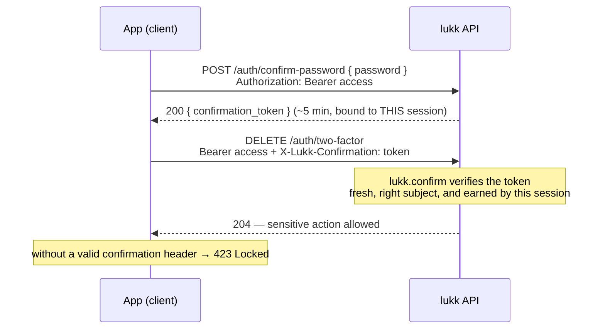
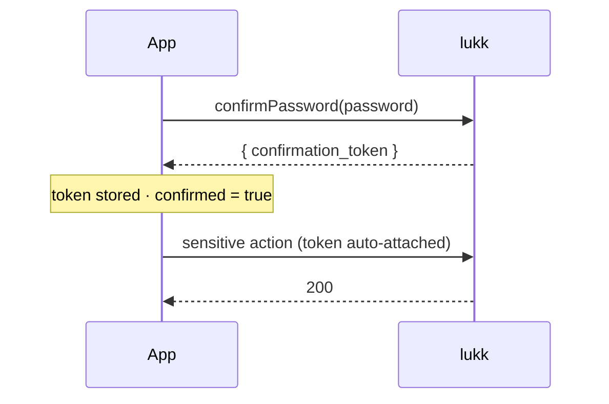

# Confirmation (Sudo Mode)

Some actions are sensitive enough that a valid session isn't sufficient — changing 2FA, managing passkeys, deleting an account — you want proof that the *person* is still there. lukk provides **step-up confirmation**: a short-lived "sudo" window, modeled on GitHub's, that the user enters by re-confirming a credential (a password or a passkey). Sensitive routes then require that proof. The server issues and verifies the token; the client's `useLukkConfirmation` earns it and auto-attaches the header.

> [!NOTE]
> The client earns the token and auto-attaches the header, so gated actions just work.

## Server (Laravel)

### How it works

1. The user re-confirms with a **password** or a **passkey** and receives a short-lived `confirmation_token`.
2. The client sends that token in a request header (default `X-Lukk-Confirmation`) on subsequent sensitive requests.
3. The `lukk.confirm` middleware checks for a valid, fresh token **earned by the session presenting it**. If it is missing, expired, or belongs to another session, the route returns **423 Locked**.

The window length is `confirm.ttl` (default 5 minutes). lukk's own [two-factor](/two-factor-authentication) and [passkey](/passkeys) management routes are protected this way.



### Bound to the session that earned it

A confirmation carries the identity of the refresh-token **family** that re-verified the credential, and `lukk.confirm` refuses one presented by a different session:

```json
// 423 Locked
{
  "message": "This confirmation belongs to a different session.",
  "reason": "confirmation_session_mismatch"
}
```

The `reason` key exists so a client can tell the two 423s apart. The plain "requires confirmation" 423 carries none and means *earn one*. This one means *discard the one you are holding and earn another* — matching on the English prose would be a drift surface of its own.

A step-up asserts "the person at this keyboard re-proved themselves just now". Bound to the subject alone it was instead bearer authority across **every** token that user held — so a machine token with a [pinned grant](/abilities), which can never earn a confirmation itself because the earning routes are ability-gated, could present the one the user's browser earned and act with it.

**Rotation does not invalidate it.** The binding is to the family, not to an individual access token, and a family survives refresh — so a token rotating mid-window keeps its confirmation. [BFF mode](/transport-modes#bff-mode) is unaffected for the same reason. A *new login* does start a new family, and the BFF discards the stored confirmation when it captures a new token pair.

::: tip Verify-only and co-issuer topologies
Matching is strict, which is what keeps a [co-issuer](/deployment#splitting-auth-and-api) working: a token minted by another service sharing the secret carries no family, and neither does a confirmation earned by it, so the two still match. What is refused is an *unbound* confirmation presented by a token that does have a family.
:::

### Earning confirmation

#### With a password

```http
POST /auth/confirm-password
Authorization: Bearer <access token>
Content-Type: application/json

{ "password": "secret" }
```

```json
{ "confirmation_token": "..." }
```

**A password step-up meets the account's own level** (lukk 0.7.0), as the passkey one already did. The confirmation token binds and removes authenticators, which NIST SP 800-63B-4 §4.1.2.1 puts at "the maximum AAL currently available in the subscriber account"; §2.2.3 lets an AAL2 session reauthenticate with one factor. So `confirm-password`:

| Session (`amr` / `auth_time` of the presenting token) | Account | Result |
|---|---|---|
| carries `mfa`, signed in within `confirm.mfa_max_age` (one day) | any | accepted |
| anything else — no `mfa`, an `mfa` sign-in older than `mfa_max_age` or dated in the future, or no `amr` claim at all | nothing stronger than the password | accepted |
| anything else | a confirmed TOTP on a guard that enforces two-factor, or a user-verifying passkey | **refused — `422` on `password`** |

In the refused case the session confirms with a passkey that verifies the user, or signs in again with its second factor first. Three cases are worth spelling out:

- **A token with no `amr` counts as single-factor.** The claim goes missing in ordinary ways — a refresh on a schema without the [`refresh_tokens.amr` column](/upgrading#highest-impact-change-right-now), a session started by `$user->startSession()` (a magic link, a social login), a co-issuer's token — and treating its absence as "old rule" would let a password-only attacker wait one refresh. **Migrate the `amr` column**, or users with a second factor have to confirm with a passkey or sign in again after every refresh.
- **`mfa` ages out.** §2.2.3 allows one-factor reauthentication *within* an AAL2 session, whose overall limit SHOULD be about a day, while `mfa` rides every rotation for the whole `refresh_ttl`. So the allowance lasts `confirm.mfa_max_age` (default `86400`) after the sign-in, read from the token's [`auth_time`](/tokens-and-rotation#the-auth-time-claim). Older sessions confirm with a passkey or sign in again. An `auth_time` more than [`leeway`](/configuration#refresh-behavior) ahead of the clock is no recent sign-in either, and neither is one before the epoch or one that isn't a number at all. A fractional `auth_time`, which a co-issuer may stamp (a NumericDate, OIDC Core §2), counts as the second it falls in, and a numeric string is read as its number. That matters when you **lower `refresh_ttl`**: `auth_time` is derived as `expires_at − refresh_ttl`, so every session signed in before the change moves forward by the difference, and a weeks-old sign-in would otherwise pass as brand new. Those sessions need a fresh multi-factor sign-in (or a passkey) to step up; raising `refresh_ttl` only ages them sooner.
- **A single-factor passkey followed by a TOTP** is `["pop","user","otp"]` — two possession factors, not `mfa` — so that session is refused here too.

An enrolled TOTP counts only where the guard enforces two-factor: with `features.two_factor` off, login never asks for the code, so no session there could carry `mfa` and the step-up would be locked away for good. The refusal comes before the password is checked, so it spends no lockout attempt and says nothing about the password. `Lukk::actingAs()`, which presents no token, keeps the old rule.

A stored hash the active hasher refuses — another algorithm, or a `$2b$` import with `hashing.bcrypt.verify` on — is a credential nobody can present, so it gets the ordinary `422` on `password`, not a `500`, as at sign-in. A password over 72 bytes against a bcrypt hash is answered with its own `422` on `password` — "Reset your password to continue" — after the check has run, since bcrypt could verify only its first 72 bytes and earlier releases stored it truncated. See [Password policy](/security#password-policy).

#### With a passkey

If [passkeys](/passkeys) are enabled, a passkey assertion earns the same token, so passkey-only users can step up too. Get the ceremony from the authenticated options route, then post the assertion:

```http
POST /auth/confirm-passkey/options
Authorization: Bearer <access token>
```

```http
POST /auth/confirm-passkey
Authorization: Bearer <access token>
Content-Type: application/json

{ "ceremony_id": "…", "credential": { … } }
```

Both endpoints return the same kind of `confirmation_token`. The credential is interchangeable only up to the account's level, though: from lukk 0.7.0 a passkey step-up must meet the **highest level the account can reach** (NIST SP 800-63B-4 §4.1.2.1), because this token is what binds and removes authenticators. A passkey that didn't verify the user is refused on an account that has a password or a user-verifying passkey, with a **`422` on `credential`** (not `403`, which would tell the client the token may never confirm). The route takes no TOTP code. See [Passkeys → Step-up with a passkey](/passkeys#step-up-with-a-passkey).

#### Throttling

Both endpoints are rate-limited (`rate_limits.confirm`, default **5 / 60s**; the passkey options route rides `rate_limits.passkeys`), keyed on **both** the user and the IP — the per-user bucket is the load-bearing one, since a caller holding a stolen access token is a single identity behind however many addresses they like. A tripped limit returns `429`.

Password confirmation re-verifies the *same* secret as login, so it also counts toward the opt-in [account lockout](/account-lockout) under the `confirm` purpose; a locked step-up answers `423`, and a successful login, a password reset or an accepted passkey step-up clears it — the last only after every check has passed, so a passkey refused for the account's level can't be alternated with password guesses to reset the count (lukk 0.7.0). `confirm-passkey` is throttled but never locked — an assertion is a signature, not a guessable secret, so there's nothing to cap.

### Gating your own routes

Apply the `lukk.confirm` middleware to any route that should require a fresh confirmation — account deletion, an email change, revealing an API key, and so on:

```php
Route::delete('/account', [AccountController::class, 'destroy'])
    ->middleware(['auth:api', 'lukk.confirm']);
```

The order doesn't matter: `lukk.confirm` is sorted after authentication, so `['lukk.confirm', 'auth:api']` works too. Up to lukk 0.6 that order read no user and answered `423` to a valid confirmation.

The client then attaches the confirmation token to the request:

```http
DELETE /account
Authorization: Bearer <access token>
X-Lukk-Confirmation: <confirmation token>
```

A request that reaches a gated route without a valid, fresh token receives `423 Locked`. Your front-end should respond to a `423` by prompting the user to re-confirm, then retrying.

### Configuration

```php
// config/lukk.php
'confirm' => [
    'ttl' => (int) env('LUKK_CONFIRM_TTL', 300),
    'mfa_max_age' => (int) env('LUKK_CONFIRM_MFA_MAX_AGE', 86400),
    'header' => env('LUKK_CONFIRM_HEADER', 'X-Lukk-Confirmation'),
],
```

| Key | Default | Description |
|---|---|---|
| `ttl` | `300` (5 min) | How long a confirmation token remains valid. |
| `mfa_max_age` | `86400` (1 day) | **lukk 0.7.0.** How long after a multi-factor sign-in a [password step-up](#with-a-password) is still accepted on an account with a second factor. Read per guard. |
| `header` | `X-Lukk-Confirmation` | The header the middleware reads the token from. |

## Client (Nuxt)

`useLukkConfirmation` is the client for lukk's server-side step-up: the user re-proves their identity, and for a short window afterwards the sensitive routes open up.

### `useLukkConfirmation`

```ts
const {
  confirmed,        // ComputedRef<boolean> — is a confirmation currently held?
  required,         // Readonly<Ref<boolean>> — a withConfirmation() action is waiting on your modal
  token,            // Readonly<Ref<string | null>>
  confirmPassword,  // (password) => Promise<void>
  withConfirmation, // <T>(action: () => Promise<T>) => Promise<T> — per-action modal flow
  cancel,           // () => void — abort a pending withConfirmation
  clear,            // () => void
} = useLukkConfirmation()
```

### How it works

When you confirm, the token is **automatically attached** in the `X-Lukk-Confirmation` header on every subsequent request — so once `confirmed` is `true`, the gated actions simply work, until the window expires server-side (lukk's [`confirm.ttl`](#configuration)). You never thread the token through your own calls.

Where the token lives depends on the [mode](/transport-modes):

- **`direct`** — the token is stored in client state and the client attaches the header.
- **`bff`** — the proxy strips the token from the response and **holds it server-side**, injecting the header itself. The browser only sees `confirmed` flip to `true`; it never holds the confirmation credential.

In `bff` mode this covers **both** proxies: the lukk auth routes *and* your own API through the [app-API proxy](/configuration#api-bff-app-api-proxy). So a route on your Laravel API gated with lukk's `lukk.confirm` middleware works through `useLukkFetch()` once `confirmed` is `true` — the token is injected from the sealed session, and a confirmation header sent by the browser is discarded rather than forwarded.



You never thread the token through your own calls — earning it is the only step.

### Confirming with a password

```ts
const { confirmPassword, confirmed } = useLukkConfirmation()

await confirmPassword(currentPassword)
// confirmed.value === true
```

A wrong password throws a typed [`LukkError`](/lukk-core#errors) (`422`). So does a password step-up [refused for the account's level](#with-a-password) — a single-factor session on an account with a second factor — also a `422` on `password`; offer [passkey confirmation](#confirming-with-a-passkey) there, or a fresh sign-in with the second factor. A `422` telling the user to reset means their password is over 72 bytes under bcrypt — send them to [password reset](/password-reset). Call `clear()` to drop the confirmation early (it also clears on [logout](/authentication#logging-out-1)).

In BFF mode, a confirmation can also reject with **`409`** when the session that asked for it was replaced by a sign-in (or ended by a logout, perhaps in another tab) while the request was out. The confirmation belonged to that session, so the proxy doesn't store it; re-confirm once the page shows the current session. The same `409` ("The session was replaced.") answers a confirmation whose request had to be renewed with a pair the session had already moved past — a response slower than the [rotation journal's](/transport-modes#a-slow-rotation) window, 30 s (up to 10 min 30 s for a rotation nobody received). Nothing is sealed from it, and the browser keeps its newer session cookie; confirm again and the step-up is recorded on that.

### Confirming with a passkey

A passkey can satisfy step-up too — see [Passkeys → Step-up with a passkey](/passkeys#step-up-with-a-passkey):

```ts
const { confirm } = useLukkPasskeys()
await confirm() // stores the confirmation token, same as confirmPassword
```

### Gating: per-action or per-page

These actions require a held confirmation; without one, lukk responds `423 Locked`:

- [Managing 2FA](/two-factor-authentication#managing-2fa) — enable, confirm, disable, regenerate recovery codes
- [Registering or removing a passkey](/passkeys#managing-passkeys)

Two shapes, both supported.

#### Per-action (a modal)

Wrap the sensitive call in `withConfirmation()`. It runs the action and, on a `423`, opens your modal (`required`), waits for a fresh confirmation, and retries once:

```ts
const { withConfirmation } = useLukkConfirmation()
const api = useLukkFetch()

async function deleteAccount() {
  await withConfirmation(() => api('/account', { method: 'DELETE' }))
}
```

Bind a global step-up modal to `required` — the user confirms (password **or** passkey), and the pending action retries automatically:

```vue
<script setup lang="ts">
const { required, confirmPassword, cancel } = useLukkConfirmation()
const password = ref('')
</script>

<template>
  <dialog :open="required">
    <input v-model="password" type="password" >
    <button @click="confirmPassword(password)">Confirm</button>
    <button @click="cancel">Cancel</button>
  </dialog>
</template>
```

`withConfirmation` drops a stale confirmation on the `423`, so it always re-prompts when the server genuinely requires one (rather than trusting an expired client flag). `cancel()` rejects the pending action. A `403` from the confirm call means the token can never earn a step-up — a [pinned](/abilities) machine token without `lukk.account` — so it ends the wait instead of leaving the modal open: the pending action rejects with that `403`, not "confirmation cancelled". That holds across instances (lukk-nuxt 0.12.0): the modal calling `confirmPassword()` and the page waiting in `withConfirmation()` are usually two `useLukkConfirmation()` calls, and the error is now held per app rather than per instance, so the page sees it. A pending action is also cancelled when its session ends — on `logout()` and on every sign-in (lukk-nuxt) — so a confirmation earned later, perhaps by another account on the same tab, can never run the old action unasked.

#### Per-page (a section)

To gate a whole page/section instead, use the [`lukk-confirmed`](/authentication#route-middleware) route middleware — stack it after `lukk-auth`; it sends an unconfirmed user to `/confirm-password`:

```ts
definePageMeta({ middleware: ['lukk-auth', 'lukk-confirmed'] })
```

Confirmation is client-session state, so a hard reload re-confirms. The server's `lukk.confirm` (423) is the real enforcement either way — these client guards are UX.

Next: **[useLukkFetch](/use-lukk-fetch)**
