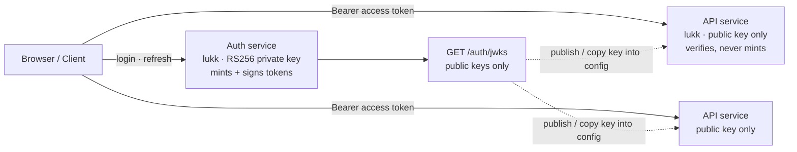

# Deployment

lukk is built for a single first-party service that issues *and* verifies its own tokens. That's the default, and most apps never need anything else. But you can also split login off from your API, mint one token for several services, or hand a public key to an independent verifier. This page covers those topologies and the operational requirements they all share.

Everything here is server-side. The client's production concerns — the BFF session secret and throttling behind a proxy — are at the [bottom of this page](#client-nuxt-in-production).

## Server (Laravel)

### Single service (default)

One Laravel app mints tokens at `/auth/login` and verifies them on every protected request. Issuer and audience are the same thing — your API — so they share a value:

```dotenv
LUKK_ISSUER=https://api.example.com
LUKK_AUDIENCE=https://api.example.com
```

Nothing else to configure. A browser SPA or a BFF in front of this API is **not** a verifier — it only holds and forwards the token — so it needs no lukk configuration of its own.

#### Same origin (front-end + API on one domain)

The simplest — and most common — setup: one domain (say `example.com`) serves the front-end **and** lukk's `/auth/*` and protected routes. Issuer and audience are just that domain:

```dotenv
LUKK_ISSUER=https://example.com
LUKK_AUDIENCE=https://example.com
LUKK_COOKIE_MODE=true
```

This is *less* work than the split sub-domain case, not more:

- **Cookie mode fits a direct browser SPA.** The refresh token rides in the `__Host-refresh` cookie (sent automatically on every same-origin request); the access token stays in memory and goes out as a `Bearer` header. (If you have a server-rendered/BFF layer, leave `cookie_mode` off and use [BFF mode](/transport-modes#bff-mode) instead.)
- **No CORS.** Same origin means no preflight and no credentialed-CORS config — the cross-origin operational note below simply doesn't apply.
- **What holds against CSRF.** Protected routes authenticate via the `Bearer` header, not an ambient cookie, so a forged request carries no credential. The refresh cookie is `SameSite=Strict`, which stops it being *sent* cross-site — but not being *set*: RFC 6265bis §5.7 stores a SameSite cookie from the response to a cross-site top-level navigation, so a forged form POST to `/auth/login` could plant the attacker's session. In cookie mode lukk therefore answers `415` on `login`, `register`, `refresh`, `two-factor-challenge` and `passkeys/login` unless the request has a JSON body (`Content-Type: application/json`) or `Sec-Fetch-Site: same-origin`/`none` (lukk 0.7.0); `logout` honours and clears the cookie only on the same shapes. lukk-js already sends JSON. In [BFF mode](/transport-modes#bff-mode) the proxy adds its own checks: a state-changing request whose `Origin` isn't the app's, or whose `Sec-Fetch-Site` is `cross-site` or `same-site`, is refused, and so is a `cross-site` or `same-site` GET that isn't a top-level navigation. Laravel's token-based CSRF (`419`) doesn't apply to either.
- **Passkeys are the easy case:** `rp_id = example.com`, `origins = ["https://example.com"]` — front-end and API share the exact origin.

lukk's own `/auth/*` routes always render JSON errors (it forces JSON on them — except `GET /auth/email/verify/{id}/{hash}`, which sits outside that group because a browser opens it from the mail: its errors (an invalid signature, a throttle) follow the request's `Accept` header like any Laravel route); if the same app also serves web routes, your *own* `auth:api` routes need the same — see [Installation](/installation#wire-the-guard).

### Splitting auth and API

You can run a dedicated **auth service** (login, refresh, logout, 2FA, passkeys) and one or more **API services** that only verify tokens. This works today, with no code changes, as long as the services trust each other — see **A note on trust** below. A browser client calling these services across origins uses the lukk-js [direct transport mode](/transport-modes#direct-mode).

**On the auth service** — the default setup. It keeps the routes, the database, and the refresh-token rotation.

**On each API service** — install lukk and configure it as verify-only:

```php
// config/lukk.php
'routes' => false,           // this service doesn't expose login/refresh/logout
```

```dotenv
LUKK_SECRET=…                 # the SAME secret as the auth service
LUKK_ISSUER=https://api.example.com
LUKK_AUDIENCE=https://api.example.com
```

Then map the guard ([Installation](/installation#wire-the-guard)) and protect routes with `auth:api` as usual. An API service needs **none of lukk's tables** — no `refresh_tokens`, 2FA, lockout or passkey tables — because it never mints or rotates anything. It only verifies the access token and resolves the user, so it still needs a user provider that can find the `sub` (your users table, or whatever your provider reads). The daily [`lukk:prune`](#pruning-expired-tokens) is a no-op there from lukk 0.7.0; on an earlier release it threw every day without the `refresh_tokens` table, so call `Lukk::disableScheduling()` on the API service.

> [!IMPORTANT]
> Point every service at a **shared denylist cache** (`denylist_store` → a Redis all of them reach). That's how a logout or a reuse-revocation on the auth service immediately stops tokens on the API services. Without it, a revoked token still works on an API service until it expires — bounded by `access_ttl` (15 minutes by default), but not instant.

> [!WARNING]
> **A note on trust.** With the default **HS256** algorithm, verifying a token requires the **same secret** that signs it — so every verifying service holds the signing key and could, in principle, mint tokens too. That's fine when the services are all yours and equally trusted. If a verifier must *not* be able to mint (a different trust domain, or least-privilege isolation), use [asymmetric keys](#asymmetric-keys) instead.

### Multiple services (audiences)

The `aud` claim says who a token is *for*. `LUKK_AUDIENCE` is comma-separated, so the **auth service** that mints the token lists every service it's for:

```dotenv
# on the auth service — mint one token for both
LUKK_AUDIENCE=https://api.example.com,https://billing.example.com
```

Each service sets **its own** audience and accepts the token when it's in the list:

```dotenv
# on the billing service
LUKK_AUDIENCE=https://billing.example.com
```

So a service's `LUKK_AUDIENCE` is exactly the set of audiences it accepts. A service whose audience isn't listed rejects the token — this is what stops a token meant for one service from being replayed against another. A single-audience token (the default) stays a plain string; only multi-audience tokens become an array.

### Asymmetric keys (RS256 / ES256) {#asymmetric-keys}

When a verifier must be able to *check* tokens but never *mint* them — a separate trust domain, or least-privilege isolation — a shared symmetric secret is the wrong tool. You want the verifier to hold only a **public** key, which means **RS256/ES256 + a JWKS endpoint**.

This is built in. Generate a signing keypair on the auth service:

```bash
php artisan lukk:keygen
```

It prints the PEM pair and the `.env` lines to set; it writes no file and touches no `.env`, so store the keys yourself (a secrets manager, or files outside the web root — each value may be an inline PEM or a path, `@/path` or bare). Set the algorithm and point lukk at the keypair:

```dotenv
# on the auth service
LUKK_ALGORITHM=RS256                     # or ES256
LUKK_ACTIVE_KID=2026-10                  # the kid stamped on every token
LUKK_PRIVATE_KEY=@/run/secrets/lukk.key  # signs
LUKK_KEY_PASSPHRASE=                     # only for an encrypted private key
LUKK_PUBLIC_KEY=@/run/secrets/lukk.pub   # verifies, and is published at /auth/jwks
```

Those feed the `keys` block in `config/lukk.php`:

```php
'keys' => [
    'active' => env('LUKK_ACTIVE_KID', 'default'),
    'private' => env('LUKK_PRIVATE_KEY'),
    'passphrase' => env('LUKK_KEY_PASSPHRASE'),
    'public' => array_filter([
        env('LUKK_ACTIVE_KID', 'default') => env('LUKK_PUBLIC_KEY'),
    ]),
],
```

The auth service now exposes `GET /auth/jwks` — a cacheable JWK Set of **public keys only**. Each verify-only API runs the same algorithm with just the **public** key, filed under the issuer's `kid`, and no private key, so it can validate tokens but never sign them:

```dotenv
# on each verify-only API service
LUKK_ALGORITHM=RS256                     # match the auth service
LUKK_ACTIVE_KID=2026-10                  # the ISSUER's kid — keys.public is looked up by it
LUKK_PUBLIC_KEY=@/run/secrets/lukk.pub   # public key only; no LUKK_PRIVATE_KEY
```

The verifier finds the key by the token's `kid`, so `LUKK_ACTIVE_KID` must name the issuer's: with the default config it is also the key the public PEM is filed under, and a mismatch refuses every token. During a rotation, list both keys in `keys.public` yourself (`'old-kid' => …, 'new-kid' => …`).

A lukk verifier reads that public key from its own config; it does **not** fetch a remote JWKS. The `/auth/jwks` endpoint is where you *publish* the key — copy it into the verify-only service's config, or point a non-lukk consumer (an API gateway, another framework) at the URL. Keys are addressed by `kid`, so you can rotate the signing key without forcing logouts: publish the new key alongside the old, migrate signing, then retire the old `kid` once its tokens have expired.

Time the steps against caches. `/auth/jwks` answers `Cache-Control: public, max-age=3600`, so a consumer — or a CDN in front of it — may keep the old set for an hour. **Publish the new key at least an hour before you sign with it**, or tokens carrying the new `kid` are refused by every verifier still holding the old set. Retire the old `kid` no sooner than `access_ttl + leeway` after the switch, when the last token it signed has expired. A consumer that meets an unknown `kid` should refetch the set once (rate-limited) before refusing; a lukk verifier reads keys from its own config, so for it the order is: add the new public key to `keys.public` everywhere, deploy, then switch `LUKK_ACTIVE_KID` on the issuer.

The alg is pinned from config and is **never** read from the token header — the alg-confusion defense. See [Configuration](/configuration) for the key settings and [Architecture](/architecture) for the design rationale.



### Pruning expired tokens

Refresh-token rows accumulate over time. The `lukk:prune` command deletes the **expired** ones — a revoked row is kept until it expires too, so a replay of it still resolves to reuse (and revokes its family) rather than to an unknown token:

```bash
php artisan lukk:prune
```

The package schedules this command to run **daily by default**. To take over scheduling, opt out from a service provider's `boot` method and register your own cadence:

```php
use Illuminate\Support\Facades\Schedule;
use Lukk\Lukk;

public function boot(): void
{
    Lukk::disableScheduling();

    Schedule::command('lukk:prune')->hourly();
}
```

The same command also drops spent [account-lockout](/account-lockout) counters (`--lockout-days=30`) wherever the `lukk_lockouts` table exists, whether or not `features.lockout` is on now — a lock that is still held is never pruned — and passkeys whose user no longer exists.

Each sweep skips a table that isn't there (lukk 0.7.0 for `refresh_tokens`), so the scheduled run is a harmless no-op on a verify-only API service with none of lukk's tables. Before 0.7.0 the refresh-token sweep threw there every day; on those releases call `Lukk::disableScheduling()` on such a service.

### Operational requirements

A few environment concerns that the package can't enforce for you but depends on:

- **HTTPS everywhere.** Access tokens are bearer credentials and refresh cookies are `Secure` — serve every issuing and verifying route over TLS. The hardened `__Host-` cookies lukk sets are only accepted by browsers over HTTPS. (Running plain HTTP locally has its own caveats — see [Local Development](/local-development).)
- **Trusted proxies.** Every rate limit (login, refresh, passkeys, 2FA) keys on the caller's address (via `Lukk::rateLimitKey()`, which masks IPv6 to `/64` — see [rate limits](/configuration#rate-limits)). Behind a load balancer or reverse proxy you **must** configure Laravel's `TrustProxies` to your actual proxy IPs. If it trusts arbitrary clients, an attacker spoofs `X-Forwarded-For` to mint a fresh throttle bucket per request and defeats all rate limiting.
- **Throttling behind a BFF.** A back-end-for-frontend (e.g. `lukk-nuxt` in BFF mode) sends *every* user's auth traffic from the BFF server's single IP, so the per-IP login/refresh/2FA/passkey limits collapse onto one bucket for your whole user base — as does the [logout refresh-token lookup](/configuration#throttles-without-a-key-of-their-own), which the BFF's own background revokes of replaced sessions spend alongside every visitor's logout. (The claim route keys on the authenticated user, so it isn't affected.) The fix is to have the BFF forward the real client — `lukk-nuxt`'s [`clientIpHeader`](/configuration#clientipheader) — with `TrustProxies` scoped to `Request::HEADER_X_FORWARDED_FOR`. Raising the limits instead is a stopgap, and the two do **not** compose: limits inflated to survive one shared bucket become a per-attacker-IP budget the moment forwarding works, so lower them back to the per-user defaults once it does.
- **Shared revocation store.** The denylist, the TOTP replay markers, passkey challenges, spent two-factor challenge markers, the [`claim_seconds`](/configuration#refresh-behavior) markers and the longest-lifetime record all live in the cache (`denylist_store`). Across multiple nodes this **must** be a shared, persistent store (e.g. Redis) — never the `array` driver and never a per-node cache, or a revoked token can still be accepted on another node and replay protection isn't authoritative. The rate limits count in Laravel's own rate-limiter store (`cache.limiter`, else the default cache), which must be shared too, or each node grants its own budget.
- **CSRF in cookie mode.** The refresh cookie is `SameSite=Strict` (set by lukk). If your front-end is on a different site from the API, also ensure CORS is locked to the exact front-end origin with credentials — never `Access-Control-Allow-Origin: *` with `supports_credentials`.
- **JSON error responses.** lukk's `/auth/*` routes return `401`/`422` JSON on their own (it forces `Accept: application/json`), immune to your exception config — the email verification link excepted, which a browser opens. Your *own* `auth:api` routes are not — attach the `lukk.force-json` middleware (`Route::middleware(['lukk.force-json', 'auth:api'])`) or see [Installation](/installation#wire-the-guard) for the alternatives (don't rely on `shouldRenderJsonWhen` alone; it doesn't cover the guest redirect).

Run through the full [security checklist](/security) before you ship.

## Client (Nuxt) in production

The client is mostly configuration you set once ([Installation](/installation), [Configuration](/configuration)); three things matter specifically at deploy time:

- **Anything you interpolate from `process.env` is baked into the build, so those variables must be present when you build.** A config like `` baseURL: `${process.env.API_URL}/auth` `` compiles the *value at build time* into the bundle; if the variable is unset in CI, it interpolates as the string `"undefined/auth"` and the deployed app answers `400` on every auth call. The module now fails `nuxt build` on such a value (see [`baseURL`](/configuration#baseurl)) — a `nuxt prepare` only logs it — so export the variable wherever you build. The same applies to `api.target`. If you'd rather **build once and deploy many**, don't interpolate at all: leave `baseURL` empty and set the `NUXT_` runtime override per environment (`NUXT_LUKK_BASE_URL` for `bff`, `NUXT_PUBLIC_LUKK_BASE_URL` for `direct`).
- **The session secret must be identical across every instance.** `NUXT_LUKK_SESSION_PASSWORD` is the confidentiality boundary for the sealed session cookie — the BFF equivalent of `APP_KEY`. A load-balanced deploy with per-instance secrets silently invalidates sessions, and rotating it logs everyone out. See [Configuration → the session password](/configuration).
- **Set [`session.sharedStore`](/configuration#session-sharedstore) if more than one process serves your traffic.** The BFF remembers for ten minutes which sessions a sign-in replaced or a logout ended, so a refresh still in flight for one can't write it back into the browser. By default that record is per process, so behind a load balancer without sticky sessions — or on serverless and edge runtimes, where every instance or isolate is its own process — a late request served elsewhere doesn't see it. Point it at a Nitro storage mount every instance shares, on a strongly consistent driver that expires keys (Redis, Upstash / Vercel KV — not Cloudflare KV, whose writes can take a minute to show elsewhere). Without one you fall back to lukk's `grace_seconds` window, which is what stops the race becoming a family revoke rather than a wrong-account render. The [rotation journal](/transport-modes#a-slow-rotation) is per process too, and `sharedStore` does not share it: without sticky sessions, a session's next refresh served elsewhere replays the consumed token, and only the grace window keeps that from revoking the session — use sticky sessions, or raise `grace_seconds` if lukk can be slow to rotate.
- **Throttling collapses onto the BFF's IP.** Every user's auth traffic egresses from the BFF server, so lukk's per-IP throttles — login, forgot-password, the two-factor challenge, refresh, and the logout refresh-token lookup — see one address. Set [`clientIpHeader`](/configuration#clientipheader) to forward the real client (this mirrors the server note above) — and if you had raised the limits to compensate, restore them afterwards. Keep lukk's `grace_seconds > 0` so the proxy's single-flight refresh never trips a false family revocation.

In `direct` mode there's nothing server-side to run, so the two BFF-specific concerns don't apply — it's the only option for a fully static (SSG) deploy. See [Transport Modes](/transport-modes) for the trade-off, and [Local Development](/local-development) for the HTTPS-cookie caveat when running the client locally.

Next: **[Local Development](/local-development)**
