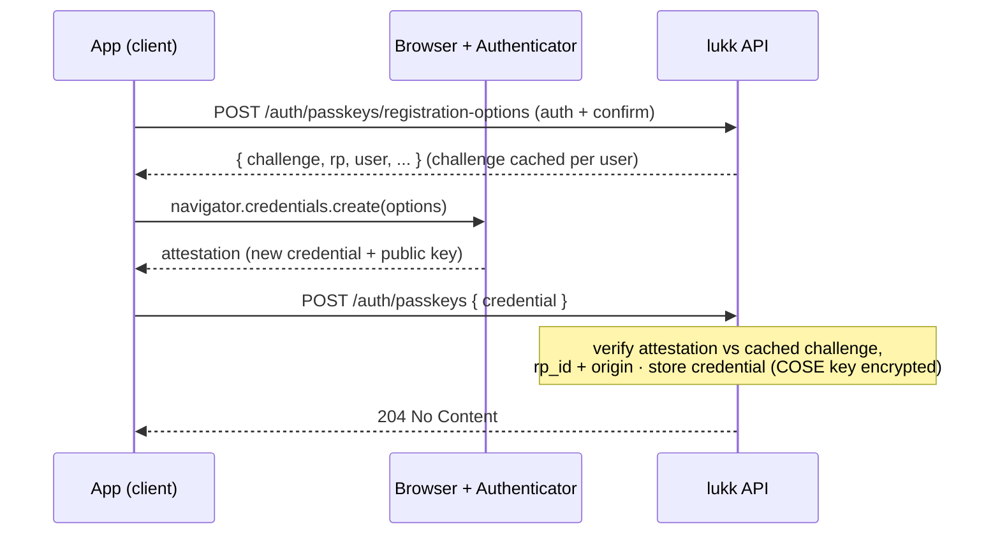
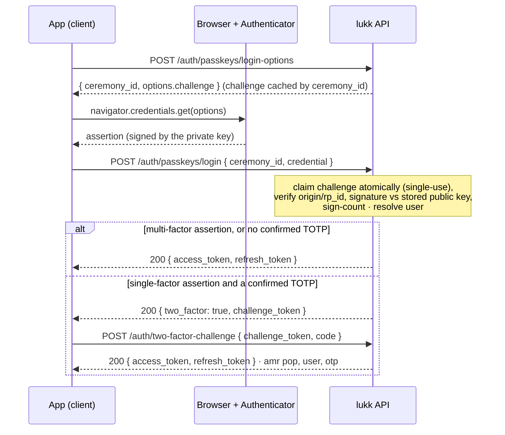
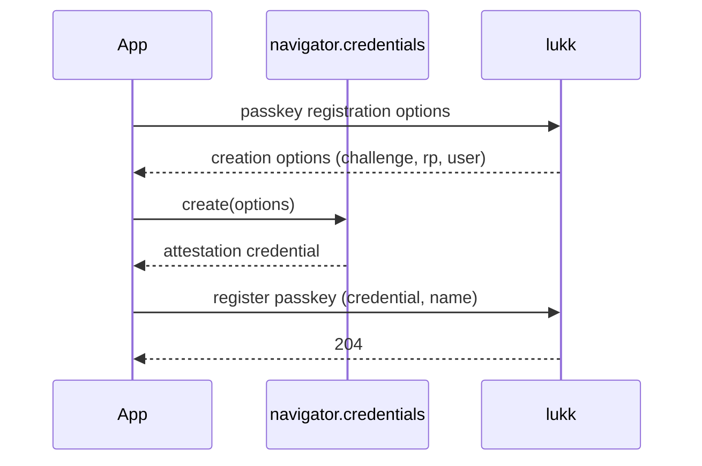

# Passkeys

lukk supports passkeys (WebAuthn / FIDO2) for **passwordless, phishing-resistant** login. A passkey is a public-key credential bound to your domain and stored on the user's device or password manager; logging in proves possession of the private key, which a phishing site can never obtain. The server owns the relying-party config, the challenges, and the credential store; the client's `useLukkPasskeys` drives the browser `navigator.credentials` ceremony.

> [!NOTE]
> Passkeys must be enabled on the server (`features.passkeys`, plus an `rp_id` and `origins`). WebAuthn requires a secure context (HTTPS, or `localhost`).

## Server (Laravel)

### Setup

Install the WebAuthn library (the default ceremony adapter wraps it), publish and run the migration, enable the feature, and set your relying-party configuration:

```bash
composer require web-auth/webauthn-lib
php artisan vendor:publish --tag=lukk-passkey-migrations
php artisan migrate
```

```php
// config/lukk.php
'features' => [
    'passkeys' => true,
    // ...
],

'passkeys' => [
    'rp_id' => 'example.com',                  // registrable domain shared by app + api
    'origins' => ['https://app.example.com'],  // your front-end origin(s)
],
```

See [Configuration → Passkeys](/configuration#passkeys) for every option.

> [!NOTE]
> The default adapter, `Passkeys\SpomkyWebAuthnCeremony`, works out of the box. To use a different WebAuthn library, rebind `Contracts\WebAuthnCeremony`.

### Endpoints

These routes are registered only when `features.passkeys` is enabled.

| Method | Path | Middleware | Purpose |
|---|---|---|---|
| `POST` | `/auth/passkeys/registration-options` | `auth` + confirm | Get a registration challenge. |
| `POST` | `/auth/passkeys` | `auth` + confirm | Verify the attestation and store the credential. |
| `POST` | `/auth/passkeys/login-options` | `throttle` | Get an assertion challenge → `{ ceremony_id, options }`. |
| `POST` | `/auth/passkeys/login` | `throttle` | Verify the assertion → token pair (`amr: ["pop","user"]`, plus `"mfa"` for a [multi-factor assertion](#when-a-passkey-counts-as-multi-factor)), or a two-factor challenge. |
| `POST` | `/auth/confirm-passkey/options` | `auth`, `throttle:lukk-passkeys` | Get a step-up challenge for the signed-in user → `{ ceremony_id, options }` (lukk 0.7.0). |
| `POST` | `/auth/confirm-passkey` | `auth`, `throttle:lukk-confirm` | Satisfy [step-up confirmation](/confirmation) with a passkey. |
| `GET` | `/auth/passkeys` | `auth` | List the user's credentials. |
| `DELETE` | `/auth/passkeys/{id}` | `auth` + confirm | Revoke a credential. |

### Registering a passkey

Registration happens while the user is logged in (and has [confirmed](/confirmation) their identity):

1. The client requests options from `/auth/passkeys/registration-options` and passes them to the browser's `navigator.credentials.create()`.
2. The browser returns an attestation, which the client posts to `/auth/passkeys`. lukk verifies it and stores the credential.



### Logging in with a passkey

Login is fully passwordless:

1. The client requests options from `/auth/passkeys/login-options`. The response includes an opaque `ceremony_id` and the WebAuthn `options`; pass the options to `navigator.credentials.get()`.
2. The browser returns an assertion, which the client posts to `/auth/passkeys/login` along with the `ceremony_id`. lukk claims the challenge, verifies the signature and then either:
   - returns the normal [token pair](/authentication#logging-in), carrying `amr: ["pop","user","mfa"]` when the assertion was [multi-factor](#when-a-passkey-counts-as-multi-factor) — or `["pop","user"]` on an account with no confirmed TOTP; or
   - answers `{ "two_factor": true, "challenge_token": "…" }` when the assertion was single-factor and the account has a confirmed TOTP. The client completes it at `/auth/two-factor-challenge`, exactly like the [password path](/two-factor-authentication#logging-in-with-2fa).

The `ceremony_id` is the UUID lukk issued. Anything else is refused with `422` before it reaches the cache (lukk 0.7.0).



The challenge is server-generated, single-use, and held server-side (in the cache) — it never travels inside a JWT. Redemption **claims** it with an atomic cache `add()` keyed on the challenge value (lukk 0.7.0), so of two concurrent requests presenting the same ceremony exactly one wins; `Cache::pull()`, which it replaced, is a get followed by a forget. The claim is atomic only on a store that implements `add()` natively (Redis, Memcached, database, file, DynamoDB) — not APC or the array store, where the cache falls back to get-then-put.

The options carry a WebAuthn `timeout` equal to [`passkeys.challenge_ttl`](/configuration#passkeys), in milliseconds (lukk 0.7.0), so the browser stops prompting when lukk forgets the challenge. Without it the browser's own default — often five minutes — applied while lukk's challenge lasted two, and a slow PIN or biometric entry ended in "could not be verified".

### When a passkey counts as multi-factor

**lukk 0.7.0.** A passkey is always possession of a key. It is *also* a second factor only when the authenticator verified the user (a PIN or a biometric), and lukk decides that per **assertion**, not from config:

- the assertion carries the user-verification (UV) flag, **and**
- the credential was already `uvInitialized` before this ceremony — it had shown user verification before.

The second condition is WebAuthn L3 §4's own rule: the UV flag must not be relied on for a credential that has never presented it. It closes the case of a stolen security key with no PIN, whose thief sets a PIN and presents UV from then on. lukk never promotes `uvInitialized` itself.

What that decides:

| Assertion | `amr` | An enrolled TOTP |
|---|---|---|
| Multi-factor | `["pop","user","mfa"]` | Skipped — the passkey already is two factors. |
| Single-factor (presence only, or UV not yet trusted) | `["pop","user"]` | **Challenged.** Login answers `{ "two_factor": true, "challenge_token": "…" }`, exactly like the [password path](/two-factor-authentication#logging-in-with-2fa). Redeeming it gives `["pop","user","otp"]`, without `mfa`. |

The last row is deliberately not `mfa`. A TOTP is possession too (NIST SP 800-63B-4 §3.1.4, §3.1.6), and two possession factors don't make multi-factor: §2.2.1 requires a password or a biometric comparison alongside a physical authenticator. Up to lukk 0.6 a passkey login skipped an enrolled TOTP unconditionally, and stamped `amr: ["webauthn"]`, a value outside the RFC 8176 registry.

`passkeys.user_verification` is still what lukk *asks* the authenticator for at login. It no longer decides whether the second factor is skipped: config is what was asked for, the assertion is what happened.

In lukk-js, `useLukkPasskeys().login()` resolves to that answer (lukk-nuxt 0.12). On a challenge it sets `pendingTwoFactor` and loads no user; complete it with `useLukkAuth().verifyTwoFactor()`, exactly as after a password sign-in.

### Managing passkeys

`GET /auth/passkeys` lists the current user's credentials, and `DELETE /auth/passkeys/{id}` revokes one (behind step-up confirmation).

Registering one dispatches [`PasskeyRegistered`](/events#authenticator-events), and removing one dispatches `PasskeyDeleted`. Listen to tell the user through another channel (lukk 0.7.0).

### Step-up with a passkey

`POST /auth/confirm-passkey` earns a [confirmation token](/confirmation), and that token is what binds and removes authenticators. So from lukk 0.7.0 it must meet the **account's own highest available level** (NIST SP 800-63B-4 §4.1.2.1):

- A **multi-factor** assertion always meets it.
- A **single-factor** assertion is refused when the account can reach AAL2: it has a password, or any passkey that has shown user verification. It is accepted only on a password-less account whose credentials are all single-factor, which has nothing stronger and would otherwise be stranded.

Negotiate the ceremony with `POST /auth/confirm-passkey/options` (authenticated) rather than the anonymous `passkeys/login-options`. It lists the user's own credentials, so a non-discoverable key works, and asks for `userVerification: required` exactly when the account can reach AAL2. The same requirement is **enforced** on the assertion, so options fetched from the login route gain nothing.

```http
POST /auth/confirm-passkey
Authorization: Bearer <access token>
Content-Type: application/json

{ "ceremony_id": "…", "credential": { … } }
```

A refused step-up answers **`422` on `credential`**, like a failed verification — not `403`. On a step-up route `403` means the token itself may never confirm, and clients abandon the prompt on it; here only the credential fell short, and the password or another passkey still works. The route takes no TOTP code: a TOTP is possession, like the passkey, so it can't lift the step-up to AAL2.

### Split-domain (BFF) deployments

When your front-end and API live on different subdomains (`app.example.com` and `api.example.com`), set:

- **`rp_id`** to the registrable domain they share — `example.com`, **not** `api.example.com`.
- **`origins`** to include the front-end origin — `https://app.example.com` — because the browser reports the front-end's origin, not the API's.

### Security notes

- Credential IDs are globally unique, and the COSE public key is **encrypted at rest**.
- A regressing signature counter is rejected and dispatches `Events\PasskeyCloneDetected`, but a `0` counter is never flagged — synced passkeys (iCloud, Google, 1Password) always report `0`. The stored counter only ever moves forward (lukk 0.7.0): the write is conditional on the stored value being lower, so two concurrent assertions can't roll it back and let a clone presenting the higher value pass later.
- `rp_id` and `origins` are **required** when passkeys are enabled — lukk throws on an empty value rather than fall back to a weak default.
- By default lukk **asks for user verification** at login (`user_verification` → `required`) — the authenticator must verify the user (biometric/PIN), not just their presence. Lower it to `preferred` only if you must support authenticators that can't verify the user (see [Configuration](/configuration#passkeys)). Whether a given login *was* multi-factor is read from the assertion, [not from this setting](#when-a-passkey-counts-as-multi-factor), and a step-up sets its own requirement.
- Registration is verified against the COSE algorithms lukk advertised in the options (WebAuthn L3 §7.1), not a library default.
- An undecryptable stored credential (a rotated `APP_KEY` without `app.previous_keys`, a corrupt row) reads as one that doesn't match, rather than a `500`.
- Passkey storage sits behind `Contracts\PasskeyRepository` (`passkeys` table) and is swappable — see the [note on replacing it](/customization) under multiple guards.
- Credentials are **scoped to a guard** (a `guard` column, as of `0.6.0`). Under [multiple guards](/multiple-guards) the assertion lookup takes a credential id and no user, so without scoping an admin's authenticator could resolve on the users guard. Single-guard installs are unaffected and the column stays null.

> [!WARNING]
> Passkeys are only as phishing-resistant as your weakest fallback. In lukk's default model, password login is always available — so deleting all passkeys can never lock a user out. For a **passwordless-only** deployment, guard the last credential at your application layer and ensure any recovery path is itself phishing-resistant; otherwise an attacker can downgrade to the weaker method.

## Client (Nuxt)

`useLukkPasskeys` drives the browser ceremony (`navigator.credentials`) and the base64url (de)serialization for you — you just `await` a verb. If the browser resolves the ceremony with no credential, the verb rejects with `lukk: the browser returned no passkey credential` rather than a `TypeError` from deep in the serializer (lukk-nuxt 0.12.0).

> [!IMPORTANT]
> Passkeys are phishing-resistant only because the authenticator binds each assertion to the **browser-facing origin**. Set lukk's `rp_id` to your app's registrable domain and `origins` to the exact origin in the address bar — **not** the lukk API host. In BFF mode the browser talks to your app, so the RP is your app's origin, even though the API lives elsewhere. Avoid wildcard origins. See [Split-domain (BFF) deployments](#split-domain-bff-deployments) above for setting `rp_id`/`origins` on the server.

### `useLukkPasskeys`

```ts
const {
  register, // (name?) => Promise<void>
  login,    // () => Promise<LoginResult> — passwordless; a session, or a two-factor challenge
  confirm,  // () => Promise<void>   — step-up via passkey
  list,     // () => Promise<{ passkeys: PasskeySummary[] }>
  remove,   // (credentialId) => Promise<void>
} = useLukkPasskeys()
```

### Registering a passkey

Registration is a sensitive action, so it sits behind [step-up confirmation](/confirmation). Confirm first, then register:



```ts
const { confirmPassword } = useLukkConfirmation()
const { register } = useLukkPasskeys()

await confirmPassword(currentPassword) // step up
await register('My MacBook')           // name is optional
```

The browser prompts the user to create the passkey; `register` handles the options, the ceremony, and posting the result to lukk.

### Passwordless login

`login()` runs the assertion ceremony and, on success, persists the tokens and loads the user — no email or password. It resolves to a `LoginResult`: when the assertion was single-factor and the account has a confirmed TOTP, lukk answers with a two-factor challenge instead of a session, `pendingTwoFactor` is set, and no user is loaded:

```vue
<script setup lang="ts">
const { login } = useLukkPasskeys()
const { pendingTwoFactor } = useLukkAuth()

async function signInWithPasskey() {
  await login()
  if (pendingTwoFactor.value) {
    return navigateTo('/two-factor') // complete it with useLukkAuth().verifyTwoFactor()
  }
  await navigateTo('/dashboard')
}
</script>
```

A user can register a passkey on one device and sign in with it on another (synced passkeys "just work" — lukk never flags a zero sign-count).

### Managing passkeys

List the user's passkeys for a settings screen, and remove one by its credential id:

```ts
const { list, remove } = useLukkPasskeys()

const { passkeys } = await list()
// passkeys: { id, name, last_used_at }[] — never the key material

await remove(passkeys[0].id)
```

> [!NOTE]
> Removing a passkey is a sensitive action and is gated behind [confirmation](/confirmation) on the lukk side.

### Step-up with a passkey

A user can also satisfy [step-up confirmation](/confirmation) with a passkey instead of their password — convenient, and phishing-resistant:

```ts
const { confirm } = useLukkPasskeys()
await confirm() // runs an assertion → stores a confirmation token
```

`confirm()` asks lukk's step-up options (`passkeyConfirmationOptions()`, `POST /auth/confirm-passkey/options`), so the authenticator is asked for user verification whenever lukk will require it. Against a lukk older than 0.7.0 that route answers `404`, and only then does it fall back to the login options. A `403` from the options route abandons the pending confirmation, as a `403` from `confirm-passkey` already did. A passkey that falls short of the account's level rejects with a `422` on `credential`; offer the password instead.

After `confirm()`, the next sensitive action (managing 2FA, registering another passkey) is authorized, exactly as if they'd re-entered their password. See [Confirmation](/confirmation).

Next: **[Email Verification](/email-verification)**
