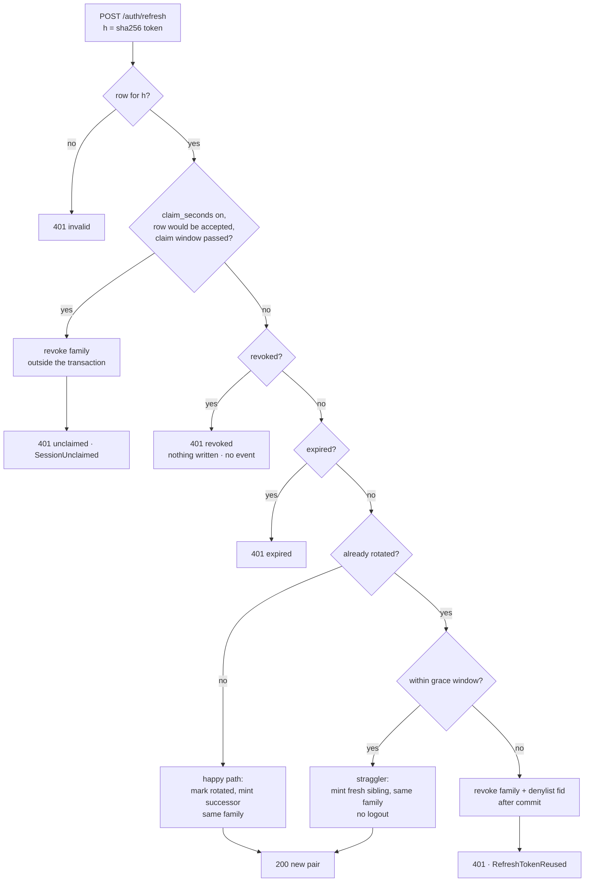

# Tokens & Rotation

This is the deep dive on lukk's two tokens: what the access JWT contains and how it's verified, and how refresh tokens rotate, detect reuse, and get revoked. It's server-centric — lukk mints and validates the tokens — with notes on how the client experiences each mechanism. For where the tokens physically live in the browser, see [Transport Modes](/transport-modes); for the request-lifecycle overview, [How It Works](/how-it-works).

## The access token

The access token is an HS256 JWT, valid for 15 minutes. It carries these claims, with the header `typ=at+jwt`:

| Claim | Meaning |
|---|---|
| `iss` | Issuer — your API's configured URL. |
| `aud` | Audience — the API the token is bound to. |
| `sub` | Subject — the authenticated user's id. |
| `fid` | Refresh **family** id — ties the access token to its refresh-token lineage, so a family revoke can kill it. |
| `jti` | Unique token id — the denylist key for this individual token. |
| `iat` / `nbf` / `exp` | Issued-at / not-before / expiry. |
| `amr` | How the session was authenticated ([RFC 8176](https://www.rfc-editor.org/rfc/rfc8176)) — see below. |
| `auth_time` | When the session was signed in (lukk 0.7.0) — see below. |

Two more claims appear only when [abilities](/abilities) are in use: `scope` and `pin`.

### The `amr` claim

`amr` lists the authentication methods behind the session, using only values registered under RFC 8176 (lukk 0.7.0):

| Sign-in | `amr` |
|---|---|
| Password | `["pwd"]` |
| Password + TOTP or recovery code | `["pwd","otp","mfa"]` |
| Passkey, multi-factor assertion | `["pop","user","mfa"]` |
| Passkey, single-factor assertion | `["pop","user"]` |
| Passkey (single-factor) + TOTP | `["pop","user","otp"]` |

`mfa` marks two *different* factor categories, so gate "was this multi-factor" on `mfa`, and "was a passkey used" on `pop`. A single-factor passkey plus a TOTP is two possession factors and carries no `mfa` (NIST SP 800-63B-4 §2.2.1). See [Passkeys](/passkeys#when-a-passkey-counts-as-multi-factor) for what makes an assertion multi-factor. Releases up to 0.6 emitted `["webauthn"]` for a passkey, a value outside the registry, and `["pwd","otp"]` for a password with a code.

`amr` is **stored with the session** (the `refresh_tokens.amr` column) and carried forward by every rotation. Up to 0.6 only the sign-in stamped it, so it vanished from the first refreshed access token, and a route gated on it stopped working about one `access_ttl` into each session. It is also **reserved**, like `scope` and `pin`: applied after the [`tokenClaimsUsing`](/customization#custom-token-claims) merge, so a claims hook can neither forge a method the session never used nor erase the real one.

### The `auth_time` claim

`auth_time` (lukk 0.7.0, [OpenID Connect Core §2](https://openid.net/specs/openid-connect-core-1_0.html#IDToken)) is the Unix time the session was **signed in**, not when this access token was minted. It is stamped at sign-in and **stored with the session**, in the same `refresh_tokens.amr` column as `amr` (`{"amr":[…],"auth_time":…}`), so every rotation carries the real sign-in time and changing `refresh_ttl` doesn't move it. (Earlier builds re-derived it on rotation as `expires_at − refresh_ttl`, so lowering `refresh_ttl` made old sign-ins look recent.) A session whose row holds no time — signed in before the time was stored, a bare `amr` list, or a custom [repository](/customization#swapping-storage) that drops the column — carries **no** `auth_time` after its next refresh, and anything leaning on a recent sign-in treats it as none until the user signs in again. Like `amr` it is **reserved**: a claims hook can neither set it nor remove it.

Use it to age out decisions that `amr` alone would make for the whole 30-day refresh life. lukk does so itself: a password [step-up](/confirmation#with-a-password) leans on `mfa` only for [`confirm.mfa_max_age`](/configuration#confirmation) (one day) after `auth_time`, since NIST SP 800-63B-4 §2.2.3 lets an AAL2 session reauthenticate with one factor while it *is* an AAL2 session, whose overall limit SHOULD be about a day. A missing `auth_time`, one more than `leeway` ahead of the clock, one before the epoch, or one that is not a number at all counts as no recent sign-in (lukk 0.7.0) — a fraction is floored to the second it falls in — so a co-issuer's token can't pass a far-future time off as fresh, and those sessions need a new multi-factor sign-in to step up with a password.

It's **stateless**: the guard verifies it by checking a signature and these claims, with no database lookup for the token itself.

### Algorithm pinning

On every request the signing algorithm is **pinned from config and never read from the token header**. This is the defense against the classic `alg` confusion attacks — an attacker can't downgrade to `alg=none`, and (under asymmetric keys) can't present an HS256 token signed with the public key as the HMAC secret. Alg mismatches are rejected outright. The JWS layer itself is delegated entirely to the audited `firebase/php-jwt`; lukk never hand-rolls encode/verify.

### Claim validation

Every request asserts the security-relevant claims:

- `iss` and `aud` must match your configuration — a token minted for another service won't verify.
- `exp` is required and enforced; `nbf`/`iat` are honored when present. Each must be a timestamp (a NumericDate, RFC 7519 §2): a number — a fraction is allowed, and so is a numeric string some issuers send — between the epoch and the end of year 9999 (lukk 0.7.0). A token outside that range is rejected; a co-issuer holding the key could otherwise stamp `exp: 1e30`, and every later integer cast of it — on logout, logout-all and, with [`claim_seconds`](/configuration#refresh-behavior) on, every authenticated request — was a `500`. Two-factor and step-up [challenge](/two-factor-authentication#logging-in-with-2fa) tokens take the same upper bound on their (integer) `exp`.
- The `typ=at+jwt` header is **stamped and asserted** (RFC 9068 §2.1; RFC 8725 §3.11 explicit typing) — a 2FA/step-up *challenge* token (same key, `iss`, and `aud`) is therefore rejected when presented as a bearer. The long form `application/at+jwt` is accepted too, case-insensitively, as RFC 9068 §4 permits. A token carrying a `crit` header is refused, since lukk understands no extension.
- `aud` must be a string or an array of strings (RFC 7519 §4.1.3); a JSON object is refused (lukk 0.7.0), where a matching value inside one used to pass.
- The denylist is checked by both `jti` and `fid`, so a single revoked token or a whole revoked session is caught. Both must be scalars, like `exp` and `sub` (lukk 0.7.0): a co-issuer token carrying `"jti": ["a","b"]` used to cast to the literal `Array`, which no longer matched its family's denylist entry (RFC 8725 §3.10).
- `sub` must be something the guard's user column can hold (lukk 0.7.0). A `sub` containing a NUL byte is refused for every provider (pdo_pgsql truncated `alice\0x` to `alice`). Where the model itself makes the column's shape certain — its auth identifier is its key, and that key is the stock auto-incrementing integer (`id()`/`bigIncrements`), a `HasUuids` UUID or a `HasUlids` ULID — a `sub` the key cannot hold (`"admin"`, `"1.5"`, `"+1"`, `"01"`, a value past signed 64 bits, a non-UUID or non-ULID) is a `401` with no query. Every other shape goes to its provider unchecked: a non-incrementing (Snowflake) key, an identifier that is another column, a uuid column the model declares nothing about, a domain type, a custom provider, and a value past int4 for a legacy 32-bit `increments('id')`. On PostgreSQL a `sub` such a column cannot hold raises SQLSTATE `22P02`/`22003`, reported as a `500`; MySQL and SQLite coerce it and find no user. That is deliberate: the token is signed by an issuer you trust, so a subject its column cannot hold is that issuer's bug, and lukk neither reads your schema on every request nor guesses which database errors are a bad token — both hid real faults or cost a query per request when tried. A co-issuer must mint subjects your identifier column holds. Likewise a `fid` that isn't a UUID names no family in lukk's table — it isn't pinned, and there are no rows of it to revoke or to spare — so change-password, logout, `DELETE /auth/sessions(/others)` and the [pinned-ability gate](/abilities#lukk-s-own-routes) no longer compare it with PostgreSQL's native `uuid` column (a `500`); a revoke still denylists it. An empty `fid` is no `fid` at all.

### HS256 by default

HS256 (a shared secret) is the correct default while your application is the only thing verifying its own tokens — there's no keypair to distribute and no JWKS to publish. RS256/ES256 + a JWKS endpoint + `kid` key rotation are implemented behind the same contracts for the day an independent service must verify your tokens without holding the signing secret; it's a configuration change (`php artisan lukk:keygen`, flip `LUKK_ALGORITHM`), not a rewrite. See [Deployment → Asymmetric keys](/deployment#asymmetric-keys).

## The refresh token

The refresh token is an opaque, 256-bit random string, valid for 30 days. It's **not** a JWT and carries no readable claims. It's returned to the client once and stored server-side **only as a `sha256` hash** — never logged, never serialized into any client bundle, never JS-readable. Its sole purpose is to obtain a new access token when the old one expires.

Every refresh token belongs to a **family** (`family_id`) that stays stable across a rotation chain. That family id is what links a refresh lineage to the access tokens minted from it (via the `fid` claim), and it's the unit of revocation.

## Rotation

Refresh is atomic and reuse-detecting. In pseudocode:

```
POST /auth/refresh (opaque refresh token RT):
  h = sha256(RT)
  row = SELECT ... WHERE token_hash = h        # unlocked pre-read
  if claim_seconds on and the transaction would ACCEPT this row:
      claim the session, or -> 401 unclaimed   (SessionUnclaimed; never RefreshTokenReused)
  resolve abilitiesUsing / tokenClaimsUsing    # no consumer code under the lock
  in a transaction:
    row = SELECT ... WHERE token_hash = h FOR UPDATE
    if no row              -> 401 invalid
    if row.revoked_at      -> 401 revoked          (its family's revoke already ran; nothing written, no event)
    if row.expires_at past -> 401 expired
    if row.rotated_at:
        if within grace    -> mint a fresh successor sibling, same family (a straggler; no logout)
        else               -> revoke family; 401   (post-grace replay = theft; RefreshTokenReused)
    if denylist has fid    -> revoke family again after commit; 401   (a revoke is in flight)
    # happy path:
    mark row rotated; insert successor in the same family
  mint a new access token
  return { access, refresh, expires_in }
```

The [`claim_seconds`](/configuration#refresh-behavior) check runs **before** the transaction, and only for a token the transaction would go on to accept — a rejected one isn't a use, and reuse detection has to stay the thing that decides a replay. It is hoisted out for the same reason the `abilitiesUsing` / `tokenClaimsUsing` callbacks are: a cache round trip must not extend the row lock, and the revocation it may perform must run outside a transaction. An unclaimed session answers the same `401` as every other rejection and dispatches [`SessionUnclaimed`](/events#sessionunclaimed) — never `RefreshTokenReused`, because nothing was replayed.



The reasons in the pseudocode (`invalid`, `revoked`, `expired`, `unclaimed`, `reuse`) are internal — they decide the event and the revoke. The client always gets the same body, `{"message": "The refresh token is invalid or has expired."}` with `401`, so a rejection says nothing about why.

The family is revoked **after** the transaction commits, never inside it — revoking inside the transaction and then throwing would roll back the revocation while the denylist cache write persisted, leaving an inconsistent state.

## Reuse detection

Rotation alone isn't the point; reuse detection is what makes it worth doing. When a token that has **already been consumed** is presented after the grace window, that's the signature of a stolen token being replayed — so lukk revokes the **entire family** and denylists it by `fid`: every live access token for that session is refused from its next request on, since the denylist is checked on each one. (`access_ttl` is how long the denylist *entry* lives — [long enough to outlast every token it covers](#the-denylist-and-revocation) — not how long the tokens keep working.) It also dispatches [`RefreshTokenReused`](/events) so you can alert on it.

That event fires **only** for a genuine replay — a consumed token presented past the grace window. Presenting a token that was already revoked — the ordinary case of a client retrying with one it still held across a logout — returns the same `401` as every other rejection, but is not reported as reuse: it isn't evidence of theft, and a steady drip of benign events would bury the alarm that is.

From lukk 0.7.0 such a token also **does no work**. Its row carries `revoked_at`, so its family's revoke has already run; re-revoking it wrote the denylist and two `UPDATE`s on every presentation, which made one dead token replayed at an unauthenticated route a write amplifier. The one case still revoked again is a *live* row whose family is already on the denylist — a revoke still in flight — so the successor it just inserted is caught after commit.

## The grace window

The **grace window** (`grace_seconds`, default 30s) is the counterweight that prevents false positives. Legitimate concurrent refreshes — multiple tabs, SSR + hydration — present the same token nearly simultaneously; within the window the older one is served a fresh access token under the same family rather than being treated as theft.

> [!WARNING]
> **In lukk 0.5.0 and 0.6.x the window was broken on PostgreSQL and MySQL** (fixed in 0.7.0). Counting the family's live tokens for [fork detection](/configuration#fork-detection) — run on every re-consumption inside grace — compared the datetime `expires_at` with a Unix integer. PostgreSQL refused the query, so two tabs refreshing with one token got a `500`, and the retry, past grace, revoked the family: a false logout under ordinary concurrency. MySQL counted nothing, so [`RefreshFamilyForked`](/events#refreshfamilyforked) never fired. SQLite, the test suite's engine, hid both. The concurrency suite now runs an in-grace sibling rotation on both engines.

### A deliberate deviation from the spec

Worth stating plainly, because it is the one place lukk knowingly departs from the standards it otherwise follows.

[RFC 9700 §4.14.2](https://www.rfc-editor.org/rfc/rfc9700) and [OAuth 2.1](https://datatracker.ietf.org/doc/html/draft-ietf-oauth-v2-1) describe rotation identically, and **neither provides for a tolerance window**:

> The previous refresh token is invalidated but information about the relationship is retained by the authorization server. If a refresh token is compromised and subsequently used by both the attacker and the legitimate client, one of them will present an invalidated refresh token, which will inform the authorization server of the breach. […] it will revoke the active refresh token.

Within `grace_seconds`, lukk **detects** that replay and deliberately does **not** revoke — it mints a sibling. Three things bound that choice:

- **It is what the deviation buys.** Strict invalidate-on-replay means any genuinely concurrent refresh — two tabs, an SSR render racing the client — logs the user out. A direct (non-BFF) client can't be forced to single-flight, so this would be a routine false logout, not an edge case.
- **The tolerance is one token deep.** Grace is measured from each token's own `rotated_at`, so only the *immediately previous* token is tolerated; an older one in the chain is already past its window and still trips reuse detection.
- **Every major implementation does the same.** Okta ships a 30-second rotation grace period (configurable 0–60, the same default lukk uses), Auth0 a "rotation overlap period", and fosite a grace period in its refresh grant handler.

**The residual:** a thief who replays *within* `grace_seconds` of a legitimate refresh gets a sibling, and from then on both chains rotate independently — never colliding, so never tripping reuse detection. Keep `grace_seconds` as small as your concurrency tolerates, watch [`RefreshTokenReused`](/events) for the post-grace replays that *are* caught, and watch [`RefreshFamilyForked`](/events) for the fork itself.

Behind the lukk-nuxt BFF there is a second, client-side tolerance: its [rotation journal](/transport-modes#a-slow-rotation) answers a request still presenting a consumed token with the session's newest pair, so that replay never reaches lukk and neither event fires for it. It is bounded to the journal's windows and to one server process. A rotation is held for ten minutes until its pair is **delivered** — until a response carrying its cookie actually leaves, which for an app-API long-poll, a slow upload or a long render is well after lukk rotated — and for 30 s from then, for the requests already out with the old cookie: at most 10 min + 30 s in all (lukk-nuxt 0.12.0). So the journal can answer a replay up to ten and a half minutes after lukk rotated, for a rotation whose cookie never left (a browser that went away before the answer, say), and a slow response's duration + 30 s for one that left late — beyond `grace_seconds`, deliberately, rather than log out the requests still carrying the old cookie. A response slower than those windows doesn't reopen the gap: right before its cookie leaves it re-checks the journal, and if the session has moved past the pair it was handed, it withholds its session cookie so the browser keeps the newer one — and, as a backstop on the auth proxy's 401 retry, a step-up confirmation answering on such a request gets a `409` and seals nothing; the user confirms again.

### How the client experiences it

The client never asks you to manage any of this. On a `401` it calls refresh once and retries the original request (a sign-in call excepted — its `401` is the answer), and concurrent 401s are collapsed into a **single in-flight refresh** (`singleFlight`) — a page firing ten requests at once triggers one refresh, not ten. In BFF mode the proxy single-flights its server-side refresh per session for the same reason — joined only by a request presenting the token being rotated — and [journals every rotation](/transport-modes#a-slow-rotation) it makes, so a request still presenting a consumed token — one whose rotation landed after its callers stopped waiting, or a burst still carrying the old cookie — is handed the session's newest pair rather than replaying the consumed token. Both dovetail with the grace window above to keep ordinary concurrency from tripping a false family revocation. That holds within limits: the BFF's journal is per server process, so behind a multi-instance BFF without sticky sessions a request reaching another instance replays the consumed token and only `grace_seconds` protects it; and if the response carrying a new pair is lost after it left (a navigation aborts it in transit) and the 30 s that started then run out first, the browser's replay of the consumed token revokes the session — the same exposure as any rotation whose response is lost. A page render never rotates mid-page: its own app-API requests are marked and pass their token on as it is, and the session is renewed once, before the render starts, so that cookie leaves with the page. See [Transport Modes](/transport-modes) for the per-mode details.

## The denylist and revocation

Because the denylist is consulted on every request, revocation is instant. It's held in the **cache, not a table** — keyed by `jti` and `fid`, with each entry self-evicting when the token it revokes would have expired anyway. That makes revocation O(revoked sessions) rather than O(all tokens). A logout revokes one session; `DELETE /auth/sessions` revokes them all.

An entry lives for `access_ttl + leeway` — or longer, when a longer-lived token may still be out there (lukk 0.7.0). Every mint records the longest access-token lifetime this guard has issued, in the denylist store, for exactly as long as such a token can live, and a revoke covers at least that; it also covers the remaining life of the token presented with the request, which catches a rebound `TokenIssuer` that sets its own `exp`. So **lowering `access_ttl` during an incident no longer brings revoked tokens back**: before, a family revoked after the change got an entry sized to the new, shorter TTL, which expired while the older, longer tokens were still valid (RFC 7009 §2.1). A negative `leeway` counts as `0` here too (lukk 0.7.0), as it already did in the verifier, so it can't shorten an entry below the tokens it covers.

## Database schema

```php
Schema::create('refresh_tokens', function (Blueprint $table) {
    $table->ulid('id')->primary();
    $table->unsignedBigInteger('user_id')->index();
    $table->string('guard')->nullable();         // the guard this family belongs to
    $table->uuid('family_id')->index();          // stable across a rotation chain
    $table->char('token_hash', 64)->unique();    // sha256(opaque token)
    $table->ulid('previous_id')->nullable();     // audit chain
    $table->text('scope')->nullable();           // pinned grant, or null to derive per mint
    $table->text('amr')->nullable();             // how the session was authenticated (JSON list)
    $table->timestamp('rotated_at')->nullable(); // set when consumed
    $table->timestamp('revoked_at')->nullable()->index(); // hard kill (logout / reuse cascade)
    $table->timestamp('expires_at')->index();    // absolute family ceiling
    $table->timestamps();
});
```

Four columns are worth a word:

- **`guard`** (lukk 0.4.0) is null under a single guard, which never reads it. Once [`lukk.guards`](/multiple-guards) is configured, every guard — the default one included — stamps its name on the families it writes and reads only its own, so guards can't see, rotate, or revoke each other's families even where `users.id === admins.id`. Backfill existing `NULL` rows when you add a guard, or those sessions log out once.
- **`scope`** (lukk 0.6.0) is the family's pinned [ability](/abilities) grant. `null` and `''` mean different things — *derive on every mint* and *pinned to nothing* — so a replacement [`RefreshTokenRepository`](/customization#swapping-storage) has to round-trip the empty string.
- **`amr`** (lukk 0.7.0) is the family's [authentication methods](#the-amr-claim), JSON-encoded, re-stamped onto every access token the family mints. It went into the existing core migration, so a fresh install gets it and an install that already ran that migration adds the column itself (see [Upgrading](/upgrading)). Until then nothing breaks: the claim simply disappears after the first refresh, as it did before 0.7.
- **`revoked_at`** is indexed, but nothing sweeps on it: `lukk:prune` deletes on `expires_at` alone and keeps a revoked row until it expires, so a replay of it still reads as reuse rather than as an unknown token. `previous_id` is load-bearing beyond the audit chain: a row with none is the family's original, which is how [`claim_seconds`](/configuration#refresh-behavior) recognises a session's never-rotated original token.

Change the `user_id` column type if your users have non-integer keys. The migration is [publish-only](/installation), so none of this is applied for you.

Next: **[Transport Modes](/transport-modes)**
