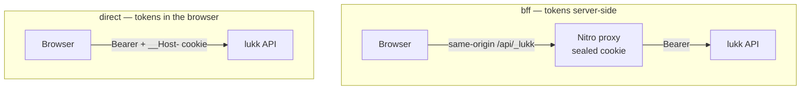
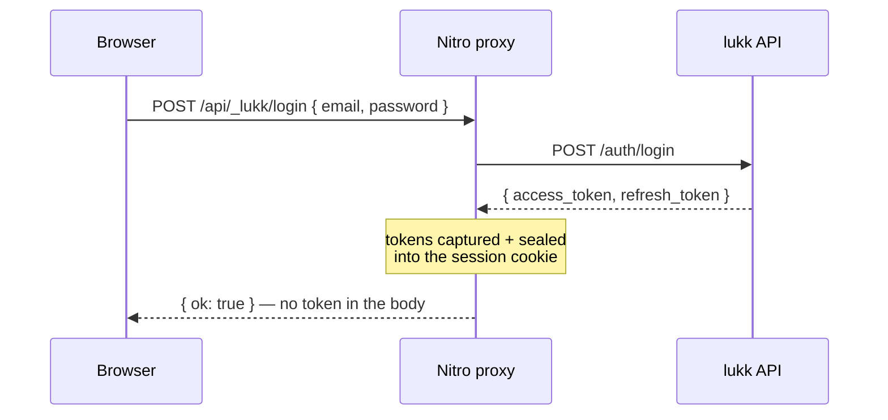
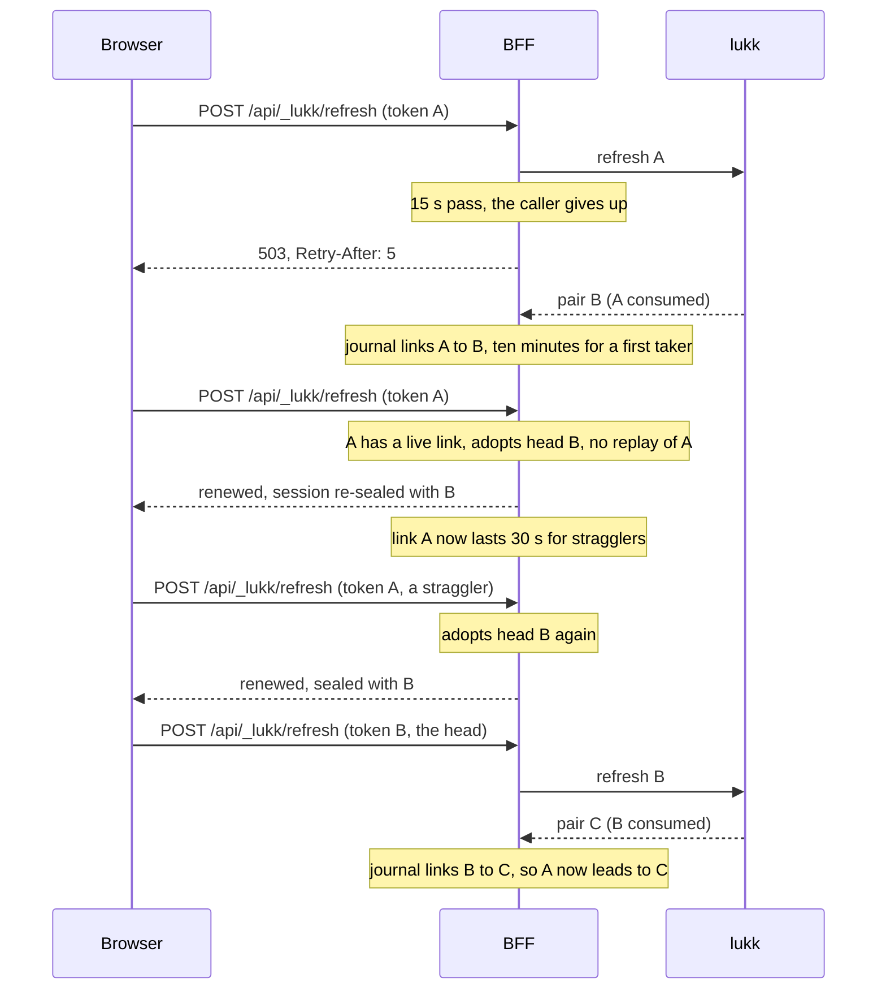

# Transport Modes

The client speaks to lukk in one of two modes. They differ only in **where the tokens live and who talks to lukk** — your component code is identical either way, because both sit behind the same composables. On the server, each client mode pairs with a lukk [output mode](/configuration#output-mode): **`bff` ↔ body mode**, **`direct` ↔ cookie mode**.



## BFF Mode

`mode: 'bff'` (the default). A Nitro server route (`/api/_lukk/**`) proxies every auth call to lukk. The tokens are captured on the server and stored in a **sealed, encrypted cookie** — the browser receives only that opaque session cookie and **never sees a JWT or a refresh token**.



The proxy also refreshes server-side: when a forwarded request comes back `401`, it uses the stored refresh token to mint a new pair, re-seals it, and retries — all without the browser noticing.

The proxy also **holds the step-up confirmation token server-side** (it strips it from confirm responses and injects the `X-Lukk-Confirmation` header itself), so neither of the two long-lived credentials nor the step-up proof reaches the browser.

One credential still does: the **two-factor login challenge token**. It is issued before any session exists, so there is no sealed session to put it in, and the browser has to hand it back to `/two-factor-challenge`. It is short-lived (`two_factor.challenge_ttl`, five minutes by default), single-use, account-throttled, and never written into the SSR payload — lukk-nuxt keeps it client-side only, because a `useState` written during a server render serialises into `__NUXT_DATA__`, and at that point in the flow there is no session cookie, so nothing marks that page `no-store`.

**Why choose it**

- The browser holds **no session token** (access, refresh, or confirmation), so XSS can't exfiltrate one. Two short-lived, non-credential cookies do reach it — the [logout note and the signed-out answer](/configuration#session-name) — and neither is a credential: the signed-out answer is a bare marker, and the note carries only the moment the logout was asked for.
- Clean SSR: the server reads the sealed session and hydrates both the authenticated **data** and the auth **state** (`user` / `loggedIn`), so authenticated pages render logged-in on the first paint — no flash, no `<ClientOnly>` (see [SSR hydration](#ssr-hydration)).
- No CORS — the browser only talks to your own origin.

**The CSRF trade-off.** Moving tokens server-side trades XSS-exfiltration risk for CSRF risk: the proxy is authenticated by the ambient session cookie. lukk-nuxt closes this — the session cookie is `__Host-lukk-session` (`SameSite=Strict; Secure; HttpOnly; Path=/`, no `Domain`), **and** the proxy rejects any state-changing request whose `Origin` doesn't match your app (a `403`), as well as a `cross-site` or `same-site` `GET` that isn't a top-level navigation — an `` on a sibling subdomain pointing at `/api/_lukk/account/export`, say (lukk-nuxt 0.12.0). Only `Sec-Fetch-Dest: document` counts as top-level: a navigation into an `<iframe>`, `<frame>`, `<embed>` or `<object>` is a navigation too, but it is the embedding site's doing, not a link the visitor followed (Fetch Metadata Request Headers §2.1). The [app-API proxy](#authenticating-your-own-api-in-bff) applies the same rule. You don't need to add your own CSRF layer for `/api/_lukk/**`.

**What else the proxy holds the line on** (lukk-nuxt 0.12.0):

- **Its route rules read the URL lukk will receive.** "Never proxy refresh", "don't refresh-and-retry a sign-in" and "clear the cookie on logout" are decided on the route the way Laravel's router reads it, with dot segments collapsed and a trailing slash trimmed. Earlier releases compared the raw path as a string, so `/api/_lukk/./refresh` or `/refresh/` reached lukk's refresh route as an ordinary proxied call. An encoded `#` or `?` in the path stays path data.
- **Its responses say what they are.** JSON goes out as `application/json; charset=utf-8` (a bare JSON string or `null` keeps its JSON form), anything else — a WAF or proxy error page, say — as `text/plain; charset=utf-8` rather than `text/html` on your app's origin, and every response carries `X-Content-Type-Options: nosniff`.
- **It bounds the request body**, which it buffers on routes reachable unauthenticated: over [`bodyLimit`](/configuration#bodylimit) (default 1 MiB) answers `413`, a chunked body `411`.
- **Every seal expires.** Each sealed session carries a lifetime, [`session.maxAge`](/configuration#session-maxage) (default 30 days), so a session cookie copied out of a browser can't be unsealed indefinitely. Every refresh re-seals.
- **The session cookie survives a browser restart.** It carries a `Max-Age` of `session.maxAge`, restarted on every write; before 0.12.0 it was a session cookie, so BFF users were signed out whenever the browser closed.
- **It works under a non-root [`app.baseURL`](https://nuxt.com/docs/api/nuxt-config#baseurl).** Nitro mounts server routes under the app's base path, and the client, `useLukkFetch`'s relative app-API base, the [`user.endpoint`](/configuration#user-endpoint) and the server's logout finish now all resolve under it (read at runtime). With `app.baseURL: '/admin/'`, earlier releases sent every sign-in, refresh and logout to the origin root, and fetched the user from there.
- **`/api/_lukk/refresh` is `POST` only.** A rotation changes state (RFC 9110 §9.2.1), so anything else answers `405` with `Allow: POST` — a prefetcher, a crawler or a same-origin `` can't spend the refresh token on a response nobody reads.
- **It gives up on a hung lukk — except mid-rotation.** The auth proxy's own calls to lukk, and the background revoke of a session the proxies drop (one a sign-in or logout replaced mid-request), time out after 15 seconds, body included, and are treated as an outage (`502`), so a lukk that sends headers and then stalls the body can't hold the request until the socket times out. **A refresh is never cut short.** lukk commits a rotation as soon as it has the request, and an abort only stops the proxy listening: the replacement token exists only in the response it walked away from, the session still holds the consumed one, and its next refresh — past the [grace window](/tokens-and-rotation#the-grace-window) — is exactly the replay that reuse detection answers with a family revoke (RFC 9700 §4.14.2). A false logout, traded for a faster error. So the refresh call waits for lukk's answer, bounded only by the runtime's own transport timeouts; every request on a session shares that one call, so a hung lukk costs one connection per session, not per request. **The requests waiting on it are bounded, though.** Each gives up after the same 15 seconds while the rotation carries on: `/api/_lukk/refresh` then answers `503` with `Retry-After: 5` and keeps the session — and lukk-nuxt's own client waits that long (at most ten seconds) and [retries once](#a-slow-rotation); a proxied auth or app-API call goes ahead with the old access token and gets lukk's `401`; a page render leaves the restore to the client. A refresh that never settles stops being shared after five minutes, so a runtime with no transport timeout of its own can't wedge a session for good, and none of these timers keeps the server process alive.
- **A `401` is retried once the session is renewed.** The proxy renews server-side and answers the browser with no token, which lukk-core used to treat as "not refreshable"; the client now retries after a renewal ([`REFRESHED_WITHOUT_TOKEN`](/lukk-core#renewed-without-a-token)).

**What it needs**

- A runtime server (Node, an edge runtime, a serverless function) — so it does **not** work for a fully static (SSG) deploy.
- A session secret, [`NUXT_LUKK_SESSION_PASSWORD`](/configuration#session-password).
- lukk in body mode (`LUKK_COOKIE_MODE=false`, its default), so the proxy receives the refresh token to seal.

> [!NOTE]
> **Throttling & `grace_seconds`.** Every user's auth traffic egresses from the BFF server's IP, so lukk's *per-IP* refresh/login [throttles](/configuration#rate-limits) collapse onto one address — including the [logout refresh-token lookup](/configuration#throttles-without-a-key-of-their-own), which the proxy's own background revokes of replaced sessions also count against. (The claim route keys on the authenticated user, so it isn't affected.) Set [`clientIpHeader`](/configuration#clientipheader) so the real client is forwarded, rather than raising the limits — an inflated limit becomes a per-attacker budget once forwarding works. Keep lukk's `grace_seconds > 0` (its default 30s): the proxy single-flights refresh, but a zero grace window turns any concurrent refresh into a full-family [revocation](/tokens-and-rotation#reuse-detection).

> [!WARNING]
> **Keep the sealed session under ~4 KB (a claims budget).** The `__Host-lukk-session` cookie holds the access JWT *plus* the refresh and confirmation tokens and a session id (about 45 bytes), iron-sealed (which inflates the payload ~1.34× on top of a fixed envelope). Per [RFC 6265bis §5.6](https://httpwg.org/specs/rfc6265bis.html#section-5.6) a browser **silently drops** any cookie whose `name`+`value` exceeds **4096 octets** — so if a bloated access token pushes the seal over the line, login appears to succeed but the cookie never persists and every following request is anonymous. This only bites when your backend embeds a large claim set via [`Lukk::tokenClaimsUsing`](/customization) (many roles/permissions/tenant data). Keep custom claims lean — put bulky authorization data behind an API lookup keyed by `sub`, not in the token. lukk-nuxt emits a one-line `console.warn` as the sealed session nears the limit so you catch it in development.

### A slow rotation

lukk commits a rotation the moment it receives the refresh, so a rotation the BFF stops waiting for is not a failed one — it is a token pair with nobody left to receive it, while the browser's sealed session still holds the refresh token it consumed. Replayed later, past lukk's [grace window](/tokens-and-rotation#the-grace-window), that token is exactly what reuse detection answers with a family revoke (RFC 9700 §4.14.2). The same goes for a page's burst of requests still carrying the old cookie after one of them has rotated it. So the BFF keeps a **rotation journal** per session (lukk-nuxt 0.12.0):

- **Every rotation is linked.** Each rotation that lands with a pair is recorded as a link from the refresh token it consumed to the pair it produced, whether or not anyone was still waiting for it. Following the links from any recorded token reaches the chain's **head** — the newest pair.
- **A consumed token adopts the head.** A request still presenting a token with a live link — from the auth proxy's `/refresh` or 401 retry, the app-API proxy, or an SSR render — is handed the head and seals it, instead of replaying the spent token to lukk. If the head's own token is being rotated at that moment, the request waits for that rotation and is handed what it produced, never a token the session is spending.
- **The head's own token goes to lukk**, and the pair that comes back is linked in turn. **Any other token** — one the journal never saw — means the session has moved on: the journal is dropped and the token is lukk's to rule on, so an old cookie surfacing later meets lukk's reuse detection.
- **Each link lives on its own timer.** One whose rotation no caller received waits up to **ten minutes** for its first taker. Once its pair has reached the session, it lasts **30 seconds**, for the requests already on their way with the old cookie (a page coming back fires several at once). For a rotation a caller received, those 30 s count from when the BFF *received* the pair; otherwise from the moment a request adopts through the link or the session presents the pair it produced. A link's end is fixed in time and only ever brought forward, never pushed back — and never past the end of the link after it in its chain — so no link outlives the links after it and an old cookie is never handed a pair rotated since. Taking one link never extends another.
- **`expires_in` counts from minting.** A pair handed out from the journal — and one a caller receives directly from a slow refresh — carries what is left of its access token, counted from when the refresh left, not lukk's figure as sent.
- **Dropped when it can't help.** Besides a token outside it, the journal goes when lukk refuses one of its tokens outright (`401`/`403`) and when the session is logged out or replaced, so a logout or a sign-in never has it re-sealed. A throttle or an outage keeps it. It holds at most **16 links** per session, the oldest going first.
- **A refresh in flight is joined only by a request presenting the token it is rotating.** One presenting another token is lukk's to rule on; joining would hand it a pair its own token never earned.
- **The client retries once.** `/api/_lukk/refresh` answers a caller that stopped waiting with `503` and `Retry-After: 5`. lukk-nuxt's client reads it from [`LukkError.retryAfter`](/lukk-core#errors), waits that long (at most ten seconds), and asks once more — joining the rotation if it is still out, adopting from the journal if it has landed — instead of leaving the session until the user's next action. A `logout()` started meanwhile wakes the wait, and the retry stands down rather than renewing the session being ended.



**Two deliberate deviations**, both traded against a false logout and both bounded to the windows above:

- **Past lukk's own grace window, on a slow refresh.** A received link's 30 s count from when the pair *landed*, while lukk's [grace window](/tokens-and-rotation#a-deliberate-deviation-from-the-spec) counts from when it rotated — on receipt. So the journal can answer a replay up to the refresh's duration + 30 s after lukk rotated. Counted from lukk's rotation instead, a slow refresh's link was gone, or nearly, the moment it landed, and the requests still out with the old cookie replayed it past grace into a family revoke.
- **Not reported to lukk.** A replay the journal answers never reaches lukk, so lukk's [reuse detection](/tokens-and-rotation#reuse-detection) — and its [`RefreshFamilyForked`](/events#refreshfamilyforked) event — does not see it. RFC 9700 §4.14.2 treats a replayed consumed token as the sign of a stolen one; inside the windows above the BFF reads it as this browser catching up.

Outside the windows a replay reaches lukk as before. Inside them, an old copy of the sealed session cookie reaching the same server process is answered with the session's live pair rather than tripping a family revoke.

Two limits are accepted. **The journal is per process**, and [`session.sharedStore`](/configuration#session-sharedstore) does not share it: behind a multi-instance BFF without sticky sessions, a next request that reaches another instance replays the old token, and only lukk's grace window (`grace_seconds`, 30 s by default) keeps that from revoking the session — use sticky sessions there, or raise the grace window if your lukk can be slow to rotate. And **if the response carrying a pair is lost** (a navigation aborts it) and its link's window closes first, the browser's replay of the consumed token revokes the session — the same exposure as any rotation whose response is lost; longer windows would widen the time in which an old cookie elsewhere is answered with a live pair.

### SSR hydration

In BFF mode the server holds the session, so lukk-nuxt hydrates `useLukkAuth().user` / `loggedIn` **during server rendering** — an authenticated page renders logged-in on the first paint, with no logged-out→logged-in flash and no consumer `<ClientOnly>`. It's **on by default**; disable it with `lukk: { ssrHydrate: false }` (reverting to client-only restore).

Per request, on the server, a `session.server` plugin reads the sealed session (read-only unless it has to refresh — it never mints a cookie for an anonymous visitor), and if the access token is still valid it fetches your `user.endpoint` in-process (the same request-aware path [`useLukkFetch`](/use-lukk-fetch) uses) and seeds the user into the SSR payload. The client then hydrates with `user` already present and skips the redundant restore.

Security properties:

- **No token in the payload.** Only your app `user` resource is serialized into the HTML; the access/refresh token never leaves the server (the BFF invariant holds). Expose only fields you're comfortable shipping in the page from your `user.endpoint`.
- **`no-store` on per-user renders.** Any render for a request carrying a real session is marked `Cache-Control: no-store` — including one that ends up not hydrating (a replaced session), since components can still render that account's data — so a shared cache/CDN can't serve one user's render to another (the sealed cookie header alone does **not** prevent caching — RFC 6265bis §5.6).
- **Fails safe.** An anonymous, tampered, or expired-seal request hydrates as logged-out with no side effects (no minted cookie, no 500). An access token that's *expired at render time* is refreshed once and the session re-sealed in place — onto both the page response and the in-process request, so the same render never replays the rotated refresh token. A session that can't be refreshed, or a user endpoint that fails on the server, defers to the client restore; such a render leaves [`ready`](/authentication#waiting-for-the-session-ready) `false` so your code doesn't mistake it for an anonymous visitor.
- **`direct` mode is unaffected** — the access token lives in client memory only, so there's no server session to hydrate from; direct-mode pages stay client-hydrated.

> [!NOTE]
> **A route behind a `swr`/`isr`/`cache` rule renders signed out.** This is Nitro's behaviour, not lukk's: it hands the cached handler a request cloned with only the rule's `varies` headers, so with the default `varies` the render never sees the session cookie — the HTML is anonymous whatever the visitor brought, and a server-side call the page makes through the app-API proxy is unauthenticated. The client restores after hydration, so the visitor does end up signed in, but `ssrHydrate` buys you nothing on those routes. It is also why such a page has nothing per-visitor to replay to the next one — a property of Nitro's current behaviour rather than a promise lukk can make, which is why the browser suite pins it. Note the request is not untouched: lukk's logout middleware runs on it like any other, so a visitor finishing a logout still gets their `Set-Cookie` and a `Vary: Cookie`. To have a cached page show the user, add the cookie to the rule (`cache: { varies: ['cookie'] }`) — which puts it in the cache key too, so entries become per session rather than shared; weigh that against [what a cache further downstream does with them](/authentication#what-ready-deliberately-doesn-t-do).

> [!NOTE]
> **Additive, but a behavior change from ≤ 0.3.** SSR `useLukkAuth().user` used to be `null` on the server (populated only after client hydration); it is now populated during SSR in BFF mode. If a page special-cased "always anonymous on the server", review it (or set `ssrHydrate: false`).

### Authenticating your own API in BFF

The proxy above authenticates the lukk **`/auth`** routes. Your **own** API (and `user.endpoint`) gets no token automatically — the browser has none. Two supported ways (this pairs with lukk's [splitting auth from the API](/deployment#splitting-auth-and-api) topology when the two live on different services):

1. **The app-API proxy** (recommended) — forward `${path}/**` to a fixed Laravel `target`, injecting the bearer server-side:

   ```ts
   lukk: {
     mode: 'bff',
     api: { path: '/api', target: 'https://api.example.com' },
     user: { endpoint: '/api/me' }, // same-origin → authenticated by the proxy
   }
   ```

   `$fetch('/api/...')` from the browser is now authenticated, the token never leaving the server. SSRF-safe (fixed target), CSRF-checked — including the [cross-site subresource rule](#bff-mode) above, since it injects the bearer just as the auth proxy does (lukk-nuxt 0.12.0) — removes the inbound cookie/authorization **and any browser-spoofable `X-Forwarded-*` headers** (stamping a trusted client IP so Laravel's per-IP throttling/logging can't be poisoned), strips upstream `Set-Cookie`, marks responses non-cacheable (`private, no-store`, `Vary: Cookie`), streams the body, and never proxies `/api/_lukk/**`. It also refuses (`404`) any request whose upstream URL falls under lukk's own routes — after up to four further rounds of percent-decoding, in case a hop in front decodes again — so `/api/auth/login` can't hand a token pair to the browser when `target` and `baseURL` are the same app — see [`api`](/configuration#api-bff-app-api-proxy).

   Its responses are served on **your app's origin**, so they can't run as the app (lukk-nuxt 0.12.0): every one carries `X-Content-Type-Options: nosniff`, and one that is neither JSON nor a PDF also carries `Content-Security-Policy: sandbox`, added to the upstream's own policy (every CSP header is enforced, so it only narrows — CSP3 §4.1). An HTML error page, an SVG or an upload served inline then renders with an opaque origin and no script. Serve documents that must run script from another origin.

   > [!NOTE]
   > **Transparent refresh.** If the sealed session's access token has already expired, the proxy refreshes it server-side *before* forwarding — sharing the same per-session single-flight as the `/api/_lukk/**` auth proxy, so a concurrent auth call and app-API call rotate the refresh token exactly once (never a reuse-detection family revoke). The rotated session is re-sealed into the cookie and carried through the streamed response. A genuinely revoked session still surfaces naturally: the refresh fails and Laravel sees the (stale) bearer, returning its own `401`. The request body is never buffered.

   > [!NOTE]
   > The trusted IP is the connection peer. If Nitro itself sits behind a load balancer / CDN, that's the LB's IP — set [`clientIpHeader`](/configuration#clientipheader) to the header your edge sets so the real client is forwarded. Do not point it at `X-Forwarded-For` itself unless your edge *overwrites* it; an appended chain leaves the leftmost entry client-controlled.

2. **Your own server route** — read the token with the auto-imported read-only helper `getLukkAccessToken(event)` (it never sets a cookie, so it's safe on unauthenticated requests):

   ```ts
   export default defineEventHandler(async (event) => {
     const token = await getLukkAccessToken(event)
     if (!token) throw createError({ statusCode: 401 })
     return $fetch('https://api.example.com/me', { headers: { Authorization: `Bearer ${token}` } })
   })
   ```

To call your app API from a page or `useAsyncData`, use the auth-aware [`useLukkFetch`](/use-lukk-fetch) — a plain `$fetch('/api/...')` forwards no cookie during SSR and 401s. For forms bound to Laravel validation, use [`useLukkForm`](/use-lukk-form).

## Direct Mode

`mode: 'direct'`. The client in the browser calls lukk directly — there is no proxy. The access token is kept **in memory** (never in `localStorage`), and the refresh token lives in lukk's hardened `__Host-refresh` cookie (HttpOnly, Secure, `SameSite=Strict`), which the browser sends automatically on refresh.

> [!NOTE]
> **What lukk-js does write to web storage.** No token, but not nothing. Two keys, both scoped to your [`app.baseURL`](/configuration#session-name) so co-hosted apps stay apart:
>
> | Key | Store | Holds |
> |---|---|---|
> | `lukk:logging-out:<app.baseURL>[#<session.name>]` | `sessionStorage` (direct only) | A logout started but not known to have finished: the moment it was asked for, and the session's refresh-token family (`fid`) when one was known. One minute. |
> | `lukk:signed-in-at:<app.baseURL>[#<session.name>]` | `localStorage` (**both** transports) | When a sign-in was last *sent*, in any tab. Read by **every** logout, in both transports, right before it sends: a sign-in recorded since that logout was asked for stands it down. |
>
> Both exist so the page load after a logout can finish it — see [Logging out](/authentication#logging-out-1). **Clearing `localStorage` on logout**, a common idiom, deletes the second one, and a note with no family then has no way to tell that a later sign-in has already superseded it: the next page load can end the **newer** session. If you clear storage on logout, `await logout()` first and leave lukk's two keys alone.

> [!WARNING]
> **Two co-hosted apps in direct mode share one session, whatever their scoping.** Both keys above are scoped per app (`app.baseURL`, plus `session.name` when set), which keeps one app's notes from reaching another's. In **BFF** mode that scoping is the whole story, because each app has its own sealed session cookie. In **direct** mode it is not: lukk issues a single `__Host-refresh` cookie for the origin, so `/shop/` and `/admin/` are the same session on the server no matter how their client-side keys are named. Signing out of one signs out of both, and a refresh in one rotates the token the other is holding. Give co-hosted direct-mode apps separate origins, or put them behind BFF.

**Why choose it**

- No runtime server required — it works for a **fully static site** served from a CDN.
- Simpler deploy: there's nothing server-side to run.

**What it needs**

- lukk in cookie mode (`LUKK_COOKIE_MODE=true`), so the refresh token is delivered as the `__Host-` cookie.
- **CORS configured on lukk** for your site's exact origin, with credentials. Because the client sends `credentials: 'include'`, lukk must echo your specific `Origin` and set `Access-Control-Allow-Credentials: true` — a wildcard `Access-Control-Allow-Origin: *` is rejected by the browser when credentials are included. Getting this wrong fails *silently* as a perpetual logged-out loop. lukk's refresh cookie is always `SameSite=Strict`, so a browser never sends it cross-site: **cross-site direct mode is not supported**. Put the app and the API on the same site (`app.example.com` + `api.example.com`), or use **BFF** mode.

Call your own API with [`useLukkFetch()`](/use-lukk-fetch) here too: it attaches the in-memory bearer and single-flights a `401` refresh-and-retry (sharing `$lukk`'s refresh). Because the token is client-only, a **direct**-mode `useLukkFetch` call during SSR has no bearer — fetch your API on the client, or use **BFF** mode when you need SSR-authenticated data.

> [!WARNING]
> **The access token is reachable by JavaScript in direct mode.** It lives in client memory (never `localStorage`), but any script on the page — including injected script under XSS — can read it and call the API as the user until it expires. Minimise your XSS surface and set a strict Content-Security-Policy. The token is **not** written during SSR, so it never lands in the hydration payload; keep it that way (don't trigger `login`/`fetchUser` server-side). If you need the browser to hold *no* token at all, use **BFF mode**.

> [!NOTE]
> The access token in memory is gone on a full page reload — that's fine. On load, [session restore](/authentication#session-restore) silently refreshes from the `__Host-` cookie and you're logged back in.

## Which Mode for Which App

| Your app | Recommended mode |
|---|---|
| SSR (Nuxt with a Node/edge server) | **`bff`** |
| SPA served by a Node server | **`bff`** |
| Static site / SSG (CDN, no server) | **`direct`** |
| Prototype hitting a local lukk | either |

When in doubt and you have a server, prefer **`bff`** — keeping tokens out of the browser is the stronger default.

## Switching Modes

Flip one config value — and update the lukk side to match the [output mode](/configuration#output-mode):

```ts
// nuxt.config.ts
lukk: { mode: 'direct' }
```

```dotenv
# lukk (.env) — cookie mode for direct, body mode for bff
LUKK_COOKIE_MODE=true
```

No component, composable, or page changes. That's the point.

> [!NOTE]
> Both modes ride `Secure`, `__Host-`-prefixed cookies that a browser won't persist over plain `http`. For running either mode on `http://localhost`, see [Local Development](/local-development).

Next: **[Configuration](/configuration)**.
