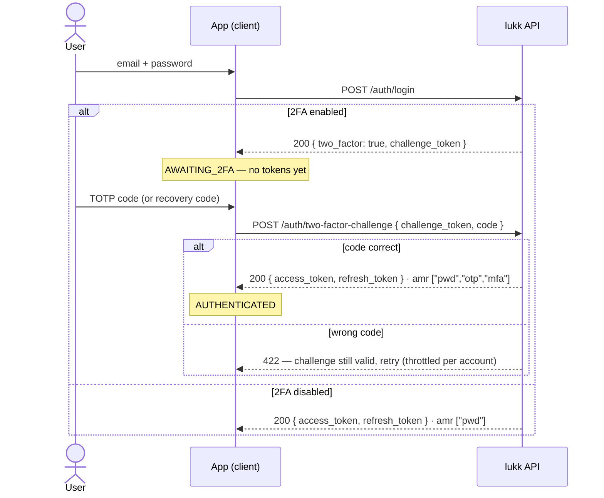
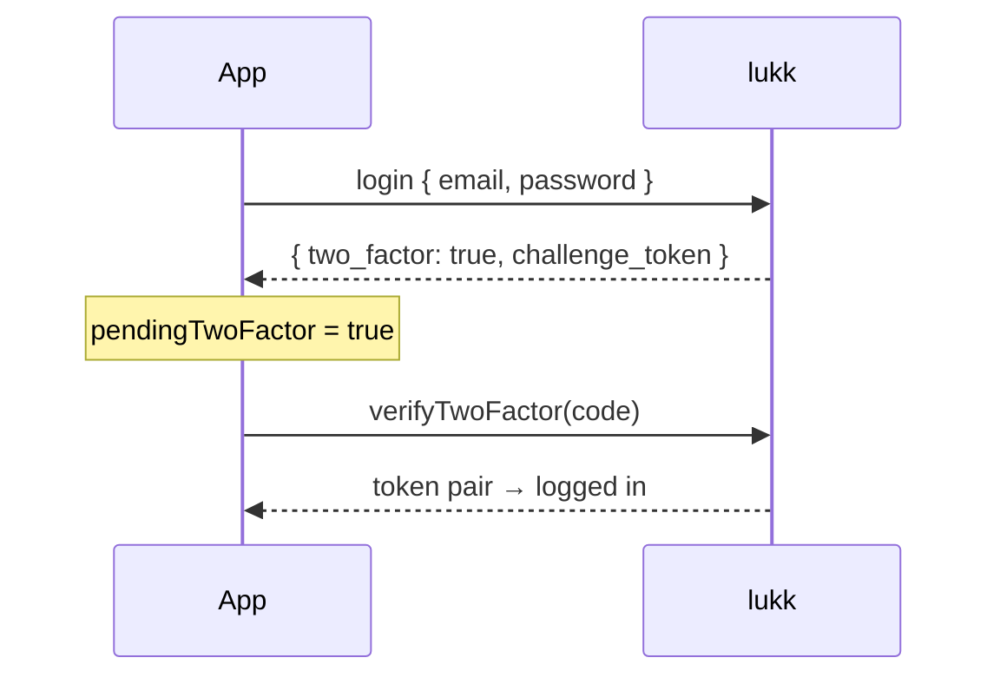

# Two-Factor Authentication

lukk ships optional, opt-in two-factor authentication (2FA) using time-based one-time passwords (TOTP) — the codes generated by apps like Google Authenticator and 1Password — with single-use recovery codes as a backup. The server owns enrolment, the challenge, and replay protection; the client drives the ceremony with `useLukkAuth` (completing a 2FA login) and `useLukkTwoFactor` (managing it).

> [!NOTE]
> 2FA must be enabled and configured on the server (`features.two_factor`). The client is inert without it.

## Server (Laravel)

### Setup

Install the TOTP library, publish and run the migration (it adds columns to your `users` table), and enable the feature:

```bash
composer require pragmarx/google2fa
php artisan vendor:publish --tag=lukk-two-factor-migrations
php artisan migrate
```

```php
// config/lukk.php
'features' => [
    'two_factor' => true,
    // ...
],
```

Add the `HasTwoFactorAuthentication` trait to your `User` model:

```php
use Lukk\Concerns\HasRefreshTokens;
use Lukk\Concerns\HasTwoFactorAuthentication;

class User extends Authenticatable
{
    use HasRefreshTokens;
    use HasTwoFactorAuthentication;
}
```

The trait manages the `two_factor_secret`, `two_factor_recovery_codes`, and `two_factor_confirmed_at` columns. See [Configuration → Two-Factor](/configuration#two-factor) for the available options.

### How it works

2FA uses a two-step enrolment and a two-step login:

- **Enrolment** is `enable` → `confirm`. Enabling provisions a secret and returns the `otpauth://` URI and recovery codes; the user must submit a valid code to `confirm` before 2FA actually activates. This prevents locking a user out with a secret they never successfully scanned.
- **Login** is `login` → `two-factor-challenge`. When a user with confirmed 2FA logs in, the login endpoint returns a short-lived **challenge token** instead of tokens; the client exchanges it, plus a code, for the real token pair.

### Endpoints

These routes are registered only when `features.two_factor` is enabled.

Switching the feature off takes a value somebody set: `false`, `0` or `'0'`. If the flag resolves to `null`, to `''` (a blank `.env` line) or is missing — for example a per-guard `'two_factor' => env('ADMIN_TWO_FACTOR')` with the variable unset — accounts that already enrolled are **still challenged**, and `POST /auth/two-factor-challenge` stays mounted so they can answer. The management routes stay off, so such an account can spend its recovery codes but not regenerate them. An unset flag is treated as a misconfiguration, not a decision to drop a factor the user opted into (lukk 0.7.0). Set it explicitly either way.

| Method | Path | Middleware | Purpose |
|---|---|---|---|
| `POST` | `/auth/two-factor` | `auth` + confirm | Begin enrolment → `{ otpauth_uri, recovery_codes }` (shown once). `409` when 2FA is already confirmed. |
| `POST` | `/auth/two-factor/confirm` | `auth` + confirm + throttle | Activate 2FA after a valid `code` (`204`). `409` when it is already on (lukk 0.7.0). |
| `GET` | `/auth/two-factor/recovery-codes` | `auth` + [`RequirePinnedAbility:lukk.account`](/abilities#lukk-s-own-routes) | How many recovery codes remain → `{ remaining, total }` (a count — never the codes). |
| `POST` | `/auth/two-factor/recovery-codes` | `auth` + confirm | Regenerate recovery codes → `{ recovery_codes }`. `409` on an account with 2FA neither on nor being enrolled (lukk 0.7.0). |
| `DELETE` | `/auth/two-factor` | `auth` + confirm | Disable 2FA. |
| `POST` | `/auth/two-factor-challenge` | `throttle` | Exchange a `challenge_token` + `code` **or** `recovery_code` for a token pair. Sending both is a `422`. |

> [!NOTE]
> The management routes that change something — enable, confirm, regenerate, disable — are gated by [step-up confirmation](/confirmation): the user must have recently re-confirmed their identity, because changing someone's 2FA settings should require fresh proof. Reading the recovery-code count is not; it needs only authentication (and, for a [pinned](/abilities#derived-vs-pinned-grants) token, `lukk.account`). The challenge is public.

**Which guard mounts what.** The management routes (and the recovery-code count) are mounted on the default guard only. Every [extra guard](/multiple-guards#what-you-get) mounts just `two-factor-challenge`, under its own path, and only while that guard enforces two-factor — the same rule its login challenges on.

`total` is the size of the set lukk actually issues: `two_factor.recovery_codes` (default `8`), clamped to 1–100 (lukk 0.7.0 — it used to report the raw setting). How long a challenge token lives is `two_factor.challenge_ttl` (default `300` seconds), read per guard. A pending secret the key can no longer decrypt (an `APP_KEY` rotated without `previous_keys`, a corrupt row) makes `confirm` a `422` on `code`, not a `500` (lukk 0.7.0) — enrol again.

### Enrolling a user

1. The user posts to `/auth/two-factor`. The response contains the provisioning URI (render it as a QR code) and the recovery codes (display them once):

   ```json
   {
       "otpauth_uri": "otpauth://totp/Example:taylor@example.com?secret=...",
       "recovery_codes": ["Xq3vT9aLkE-7nBfR2wYpZ", "..."]
   }
   ```

2. The user scans the QR code with their authenticator app and submits a generated code to `/auth/two-factor/confirm`. 2FA is now active.

### Logging in with 2FA

When a 2FA-enabled user logs in, `/auth/login` returns a challenge rather than tokens. With [`block_unverified_login`](/email-verification#blocking-unverified-login) on, an account whose email is unverified is refused with `403` ("Your email address is not verified.") **before** a challenge is issued — after the password check, so it reveals nothing a challenge wouldn't, and the user is never asked for a code on a sign-in that would be refused. A challenge that outlives the account's verified state (an email change, or the flag switched on meanwhile) is refused the same way at redemption, before the code is checked, so no recovery code is spent on it (lukk 0.7.0).

The challenge:

```json
{ "two_factor": true, "challenge_token": "..." }
```

The client submits the challenge with a TOTP `code` (or a `recovery_code`) to `/auth/two-factor-challenge`:

```http
POST /auth/two-factor-challenge
Content-Type: application/json

{ "challenge_token": "...", "code": "123456" }
```

This returns the normal [token pair](/authentication#logging-in), carrying the claim `amr: ["pwd","otp","mfa"]` to record that two factors were used (lukk 0.7.0; earlier releases stamped `["pwd","otp"]`). The same challenge follows a [passkey login](/passkeys#when-a-passkey-counts-as-multi-factor) whose assertion was single-factor; redeeming that one gives `["pop","user","otp"]`, without `mfa`, because a passkey without user verification and a TOTP are both possession factors. The challenge is single-use and short-lived, and it is spent with an atomic cache claim (lukk 0.7.0) — before, it was checked at the start of a redemption and marked spent at the end, so two concurrent redemptions with different valid factors (two recovery codes, or a code and a recovery code) could both mint a session; now the loser is refused. A wrong code leaves it usable so the user can retry, and the endpoint is throttled per account. It is also bound to the password that was checked: if that password is changed or reset before the challenge is redeemed, redemption answers `422` on `challenge_token` and the user signs in again (lukk 0.7.0). A challenge minted by an earlier release — in the minutes around an upgrade — carries no such binding and is refused the same way. That refusal comes **before** the code is checked, so it spends nothing: no recovery code is burned, no TOTP code is marked used, and no session is started.



### Recovery codes

Recovery codes let a user authenticate if they lose their device. Each code works **once**. Submit one as `recovery_code` (instead of `code`) to `/auth/two-factor-challenge`. Users can regenerate the full set at any time via `/auth/two-factor/recovery-codes`, which invalidates the old codes.

A recovery code is matched before the user's row is locked, and only spending it takes the lock, so a wrong guess no longer stalls every other write to the account while each stored code is hashed (lukk 0.7.0). Concurrent redemptions still spend a code once — the lock is taken in a transaction on the user model's own connection, so a user table on a separate directory database is covered too (lukk 0.7.0; earlier releases opened the transaction on the default connection, where the lock was released at once and two redemptions of one code could both succeed). A recovery code stored under a hasher the app has since left — bcrypt codes after a move to argon2id with `hashing.argon.verify` on — makes the hasher throw; lukk treats it as no match rather than a `500` (lukk 0.7.0), as sign-in treats such a password. Those codes can't be redeemed until the user regenerates the set under the new hasher, so plan a regeneration prompt when you switch.

Every spent code dispatches [`RecoveryCodeUsed`](/events#recoverycodeused) with the number left (lukk 0.7.0): a recovery is something the owner should hear about through another channel, and at zero they need a new set.

### Events

Confirming a TOTP dispatches `TwoFactorAuthenticationConfirmed`, removing one (confirmed or pending) dispatches `TwoFactorAuthenticationDisabled`, regenerating the codes dispatches `RecoveryCodesGenerated`, and spending one at sign-in dispatches [`RecoveryCodeUsed`](/events#recoverycodeused) (lukk 0.7.0). lukk sends no mail; listen and tell the user through another channel. See [Events → Authenticator events](/events#authenticator-events).

### Security notes

- The TOTP secret is stored **encrypted** (it must be reversible to verify codes), while recovery codes are **salted and hashed** and shown only once. Each code is two 10-character random alphanumeric halves joined by a hyphen (about 119 bits).
- A TOTP code cannot be replayed while it is still acceptable — an accepted code is cached for the whole band it verifies in, `(2 × window + 1) × 30` seconds (90 s at the default window), and rejected on reuse.
- The verification window is ±1 step (`two_factor.window`, clamped to 0–10) and should not be widened (see [Configuration](/configuration#two-factor)).
- A stored secret the TOTP library can't read (not base32, too short — a restored backup or a hand-edited row) fails the code and is reported, rather than answering `500` on every sign-in.
- **Re-enrolling over confirmed 2FA is refused** with `409`. Overwriting the secret would null `two_factor_confirmed_at` and silently switch 2FA *off*, so a user who reopened the QR screen and abandoned it would be left unprotected with nothing to notify them. Call `DELETE /auth/two-factor` first — disabling should be deliberate.
- Challenge codes are throttled per account (`rate_limits.two_factor`). Each attempt is counted **before** its code is checked and refused on the new count with a `429` on `code` (lukk 0.7.0), so concurrent guesses can't all read "under budget" first; a success clears the count. With the opt-in [account lockout](/account-lockout) enabled, a run of failed codes also locks the second factor (`423`) — but a **recovery code is never gated by that lock**, so an attacker can't strand a user by burning their TOTP budget.

> [!WARNING]
> TOTP is **not phishing-resistant**. A real-time attacker-in-the-middle (such as Evilginx) can relay a code and steal the session. For phishing-resistant authentication, use [passkeys](/passkeys).

## Client (Nuxt)

Two-factor authentication has two halves on the client: **completing a login** when a user has 2FA enabled, and **managing** 2FA (turning it on, off, recovery codes). The first lives on `useLukkAuth`; the second on `useLukkTwoFactor`.

### The login challenge

When a 2FA user logs in, lukk returns a **challenge** instead of tokens. `login` surfaces this by flipping `pendingTwoFactor` to `true` rather than completing — you show a code input and call `verifyTwoFactor`:



```vue
<script setup lang="ts">
const { login, pendingTwoFactor, verifyTwoFactor } = useLukkAuth()

const code = ref('')

async function onLogin() {
  await login({ email: email.value, password: password.value })
  // if pendingTwoFactor is now true, the template shows the code input
}

async function onVerify() {
  await verifyTwoFactor(code.value)
  await navigateTo('/dashboard')
}
</script>

<template>
  <form v-if="pendingTwoFactor" @submit.prevent="onVerify">
    <input v-model="code" inputmode="numeric" autocomplete="one-time-code">
    <button>Verify</button>
  </form>
  <LoginForm v-else @submit="onLogin" />
</template>
```

The pending challenge is held for you; `verifyTwoFactor` completes it, persists the tokens, and loads the user. A wrong code rejects with a `422` on `code` and keeps the challenge, so the user can try again. A challenge lukk refuses outright — expired, already spent, or issued before the password changed: a `422` on `challenge_token` — can never succeed, so it is dropped and `pendingTwoFactor` turns `false` (lukk-nuxt 0.12.0); show the sign-in form again rather than letting each further code spend the throttle.

### Recovery codes at login

If the user has lost their authenticator, accept a recovery code instead:

```ts
const { verifyRecoveryCode } = useLukkAuth()
await verifyRecoveryCode('Xq3vT9aLkE-7nBfR2wYpZ')
```

Recovery codes are single-use; lukk consumes the code as it completes the challenge.

### Managing 2FA

`useLukkTwoFactor` handles enrolment and teardown:

```ts
const {
  enable,                  // () => Promise<{ otpauth_uri, recovery_codes }>
  confirm,                 // (code) => Promise<void>
  disable,                 // () => Promise<void>
  recoveryCodeCount,       // () => Promise<{ remaining, total }>
  regenerateRecoveryCodes, // () => Promise<{ recovery_codes }>
} = useLukkTwoFactor()
```

> [!NOTE]
> Enabling, confirming, disabling and regenerating are sensitive, so lukk gates them behind [step-up confirmation](/confirmation). Earn a confirmation first (`useLukkConfirmation`) and the client attaches it automatically — otherwise lukk responds `423`. `recoveryCodeCount()` needs no confirmation.

### Enrolment

A typical enable-2FA flow:

```ts
const { confirmPassword } = useLukkConfirmation()
const { enable, confirm } = useLukkTwoFactor()

// 1. Step up.
await confirmPassword(currentPassword)

// 2. Begin enrolment — show the QR code and the recovery codes ONCE.
const { otpauth_uri, recovery_codes } = await enable()
// render otpauth_uri as a QR code; have the user store recovery_codes

// 3. Confirm with the first code from their authenticator app.
await confirm(totpCode)
```

`recoveryCodeCount()` returns a safe count for a settings screen (never the codes themselves) and needs only a session; `regenerateRecoveryCodes()` issues a fresh set behind confirmation. `confirm()` rejects with a `409` when 2FA is already on, and `regenerateRecoveryCodes()` with a `409` on an account whose 2FA is neither on nor being enrolled (lukk 0.7.0) — ordinary `LukkError`s for a form to show.

> [!WARNING]
> Treat `otpauth_uri` (it contains the TOTP secret) and `recovery_codes` as **authenticator secrets**. Render them once, then drop them — never put them in `useState`/a store (they'd serialize into the SSR payload), `localStorage`, logs, or analytics.

Next: **[Passkeys](/passkeys)**
